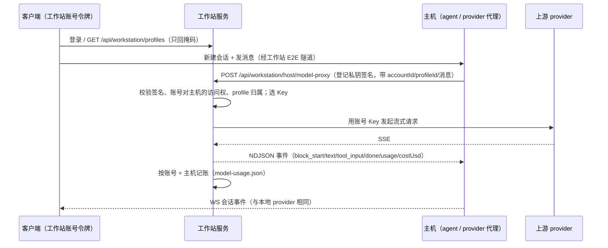

# Tandem 架构地图

> 更新：2026-11-10。

> 目标：新加入的人或 agent 只读这一页 + 目标目录的少量文件，就能安全修改；改完用 `node scripts/check.mjs` 自动发现回归。
> 与 `AGENTS.md`、`docs/design.md`、`packages/protocol/src/index.ts` 冲突时，以它们为准。

## 1. 顶层目录

| 路径 | 职责 |
|---|---|
| `packages/protocol/src/index.ts` | 客户端 ↔ Host 唯一契约：REST/WS 消息、Session/Profile/Permission/Budget 等类型 |
| `packages/server` | Host 守护进程：Fastify REST + WS、agent 循环、provider、工具、权限、持久化 |
| `packages/web` | React 19 客户端；桌面端与安卓 App 复用同一份构建 |
| `packages/desktop` | Electron 壳：内置 Host、窗口/托盘/通知、Windows 打包 |
| `packages/mobile` | Capacitor 安卓壳：前台服务、本地通知、APK 打包 |
| `e2e/smoke.mjs` | Playwright 端到端冒烟：临时 Host + 假 provider |
| `scripts/ui-audit.mjs` | UI 原语防回退审计 |
| `scripts/check.mjs` | 提交前总检查：docs → build → debug-artifacts → ui-audit → decisions → test → smoke → regression → release |
| `scripts/release.mjs` | 发布：统一版本、生成 CHANGELOG/新功能导览、提交并打本地标签 |

主机与客户端之间唯一的远程连接路径是工作站。

## 2. Server 模块地图

| 文件/目录 | 职责 |
|---|---|
| `src/cli.ts` | 入口：解析 `--port/--host`，创建 Host + Fastify，信号退出 |
| `src/server.ts` | Fastify 服务：启动、token 鉴权、WS 升级、静态托管；路由按资源在 `routes/` 下注册 |
| `src/routes/` | REST/WS 路由：`common.ts`（依赖与鉴权）、`sessions.ts`、`permissions.ts`、`host.ts`、`updates.ts`（可选 `/updates/` 桌面更新文件托管）、`profiles.ts`、`models.ts`、`usage.ts`、`tasks.ts`、`mcp.ts`、`skills.ts`、`hooks.ts`、`memory.ts`、`schedules.ts`、`evals.ts`、`subagent-presets.ts`、`prompt-templates.ts`、`commands.ts`、`external.ts`、`fs.ts`、`pair.ts`、`budgets.ts`、`config.ts`、`ws.ts` |
| `src/board/` + `routes/board.ts` | 任务看板：`manager.ts`（调度器：依赖/并发上限/重试/审批门/单卡预算/worktree 合入依赖与按序合并/重启续跑/AI 评审收尾/冲突解决/运行时提议，1s tick）、`graph.ts`（环检测、`decideSchedule`、规划草稿解析，纯函数）、`git.ts`（自动提交与统计、依赖分支合入）、`planner.ts`（AI 拆分，一次性 `completeText`，只返回草稿）、`pr.ts`（集成分支 + gh/glab 聚合 PR 与状态刷新）、`store.ts`（`~/.tandem/boards/<id>.json`）；卡片 = 带 `SessionRecord.board` 的顶层会话；`tools/propose-cards.ts` 是卡片会话的提议工具 |
| `src/model-routing.ts` / `src/routing-settings.ts` | 自动模型路由：按消息长度/关键词/上下文/失败信号打难度分，在用户候选池按快速·均衡·强力与省钱·均衡·质量偏好选模型；连续失败升级、简单成功回落，统计相对强力档的节省；设置有会话入口 |
| `src/host.ts` | Host 类：持有全部状态与构造，方法按职责转调到 `host/`（外部 API 不变） |
| `src/access.ts` | 连接身份（所有者 / 工作站账号 / 设备令牌）、角色边界、项目可见性、REST 白名单 |
| `src/accounts/` + `src/workstation/` + `routes/accounts.ts` | 工作站客户端-服务：`accounts/store.ts`（工作站初始化/注册/绑定码/主机登记/逐主机授权/旧数据迁移、Ed25519 访问/刷新令牌与 `perHost` 声明、吊销快照）；`workstation/server.ts`（独立进程：账号 API + `/_tunnel` + `/h/<id>/_e2e/*` 转发）、`workstation/manager.ts`（桌面内嵌启动）；Host 侧 `workstation/agent.ts` 建立出站隧道；设计 `docs/workstation.md`，代测 `docs/test-guides/workstation.md` |
| `src/host/` | Host 实现按职责拆分（纯搬移）：`sessions.ts`（读取/转换/CRUD）、`turns.ts`（发送/回合/排队/中断/compact）、`commands.ts`（斜杠命令/本地消息）、`permissions.ts`（审批/plan/恢复）、`keys.ts`（账号/分组/Key 轮询）、`usage.ts`（上下文/预算/模型）、`subagents.ts`（子代理/委派/工具可见性）、`vcs.ts`（git 环境/worktree）、`rewind.ts`（检查点回退）、`hooks.ts`、`inbox.ts`、`external.ts`（外部会话通知/导入）、`helpers.ts`（无状态纯函数） |
| `src/agent/loop.ts` | 单轮 agent 循环：模型 → 工具 → tool_result → 再请求，直到结束 |
| `src/agent/prompt.ts` | 系统提示组装（含注入段落清单） |
| `src/agent/commands.ts` | 斜杠命令解析与内置命令表 |
| `src/agent/resume.ts` / `retry.ts` | Host 重启续跑、网络失败重试 |
| `src/providers/` | `anthropic.ts` / `openai.ts` 适配、模型列表、能力、HTTP 错误、空闲超时；SSE 与 usage 解析在 `src/upstream/` |
| `src/upstream/` | 共享上游转发引擎：`request.ts`（请求构造、错误文本、参数降级重试）、`sse.ts`（SSE 读取与 usage 累计）、`usage.ts`（OpenAI/Anthropic usage 归并）、`keys.ts`（Key 换用循环）；网关 `gateway/proxy.ts` 与工作站 `workstation/modelProxy.ts` 共用，鉴权/限流/记账仍留在各自入口（`usage.json(memberId)` / `model-usage.json(accountId)`） |
| `src/tools/` | 每个工具一个文件（Bash/Read/Write/Edit/Glob/Grep/Task/Todo/Memory/WebFetch…），`index.ts` 注册与执行 |
| `src/store.ts` | 会话 JSON 持久化、防抖落盘、快照/恢复 |
| `src/run-state.ts` | 运行意图落盘（断点续跑、悬空审批） |
| `src/events.ts` | WS Hub：订阅、广播、每会话 seq、环形缓冲与断线重放 |
| `src/external.ts` | 只读扫描 Claude Code / Codex 会话，注入清理、标题提取、导入 |
| `src/changes.ts` | git 状态/diff/丢弃/提交（参数数组调用，不拼 shell） |
| `src/vcs.ts` | PR/CI 能力检测、创建/合并 PR、检查轮询 |
| `src/permissions.ts` | Host 级 allow/ask/deny 规则匹配 |
| `src/hooks.ts` | Claude Code 兼容 hooks 执行（只读来源 + Tandem 可编辑） |
| `src/mcp.ts` | MCP 服务器配置、连接、工具暴露 |
| `src/skills.ts` | Claude skills 扫描与启用状态 |
| `src/subagent-presets.ts` | 子代理预设（Tandem 自定义 + agents/*.md 只读） |
| `src/prompt-templates.ts` / `src/prompts/registry.ts` | 可配置提示词模板与默认值 |
| `src/memory.ts` / `src/agent/...` | 项目/全局长期记忆（写入需审批） |
| `src/wiki.ts` / `routes/wiki.ts` | 项目 Wiki：`~/.tandem/wiki/<hash>/` 分页 Markdown、模块划分、增量更新与只读生成会话；`tools/wiki-*.ts` 提供 WikiSearch/WikiRead；提示词见 registry 的 `wikiHint/wikiGenerate/wikiUpdate` |
| `src/host/message-paging.ts` + `store.ts` 的 `readMessagePage` | 会话分页：首屏尾部 200 条/2MB、`before`/`around` 向前翻页、超大工具输出只发首尾、轮次索引；JSONL 从文件末尾按块倒序读取 |
| `src/preview.ts` + `routes/preview.ts` | 应用预览：Host 端 Playwright 打开本机开发地址，截图流、设备尺寸、元素点选（选择器/可访问名/React 位置），Write/Edit 后自动刷新与改前快照；域名受浏览器白名单约束 |
| `src/devices/` + `routes/devices.ts` | 工作站设备：`adb.ts`（本机 adb devices/shell/install/logcat）、`serial.ts`（传输层：Mock 虚拟串口 + 可选 serialport）、`manager.ts`（设备级令牌、跨 Host 挂载/代理、串口锁与租约、WS 字节流、审计 `~/.tandem/devices/`）；`tools/device.ts` 暴露 DeviceList/Adb*/Serial* |
| `src/schedules.ts` | cron 解析与进程内定时任务 |
| `src/tasks.ts` | Bash 后台任务、输出缓冲、Kill |
| `src/budgets.ts` / `src/usage.ts` | 预算规则、周期累计、用量与价格计算 |
| `src/quota.ts` + `src/host/handoff.ts` | 配额预估与会话交接：读 provider 限流头与 429 冷却，按最近几轮估算可跑轮数；Key 全冷却/预算阻止/额度将尽时先存检查点再切换到备用分组或等待 |
| `src/sandbox.ts` | 命令沙箱：Write/Edit 写保护与 Bash 静态分析、网络白名单、Linux bwrap / macOS sandbox-exec 真隔离；设置页与 `docs/features/sandbox.md` |
| `src/secrets.ts` + `routes/secrets.ts` | 项目 Secrets：`~/.tandem/secrets.json` 加密存储，按项目/全局注入进程环境，日志与工具输出脱敏 |
| `src/doctor.ts` + `routes/doctor.ts` | Host 诊断：Node/数据目录/磁盘/监听/账号连通性/git/CLI/MCP/Hooks 等逐项检查，失败排序、Key 脱敏、纯文本报告；CLI `tandem-host doctor` 同款 |
| `src/key-rotation.ts` | 同组多 Key：可用性、failover/round-robin、失败分类与冷却 |
| `src/checkpoints.ts` / `src/worktree.ts` | 文件检查点回退、git worktree 会话 |
| `src/evals.ts` | 评测：用例落盘 `~/.tandem/evals`、git/目录快照、临时工作区、批量运行、检查命令、评审模型与结果持久化 |
| `src/inbox.ts` | 跨会话收件箱（审批/回合结束/预算/CI） |
| `src/demo/` + `routes/demo.ts` | 演示工作区：`manager.ts` 生命周期（创建/重播/清除/静态页回环服务）、`seed.ts` 17 个场景造数、`provider.ts` 内置演示模型（按剧本流式输出，无网络请求）；数据全部带 `demo` 标记，清除时一并移除会话/检查点/记忆/看板/评测/Wiki/任务/收件箱事件 |
| `src/search.ts` | 会话全文索引：纯 JS 倒排（英文词、中文单字+bigram+Segmenter），覆盖 Tandem/外部会话正文与工具命令/路径，增量更新并落盘 `~/.tandem/index/search.json` |
| `src/config.ts` | `~/.tandem` 路径、账号存储、Host 配置、密钥掩码 |
| `src/migrate.ts` | 配置加密导出/导入 |
| `src/workstation/agent.ts` + `tunnel.ts` + `wire.ts` + `e2e.ts` | 主机出站隧道、隧道多路复用、线协议与 E2E 通道 |
| `src/util/` | 纯工具：路径、编码、glob、fs-walk、文本、HTML、文件预览 |

## 3. Web 模块地图

| 文件/目录 | 职责 |
|---|---|
| `src/App.tsx` | 布局、hash 路由、全局快捷键、移动端抽屉 |
| `src/store/useAppStore.ts` | 全局 store 入口：只做初始 state 与各 slice 的组合（见 §8） |
| `src/store/appStore/` | `types.ts` 状态与 action 签名；`helpers.ts` 纯工具与连接表；`sessionCore.ts` 会话内部辅助（`patchActive`/`applySnapshot`/`ensureConnection` 等）；`serverMessages.ts` WS 消息 switch；`hostsSlice.ts`、`sessionsSlice.ts`、`messagesSlice.ts`、`inboxSlice.ts`、`worktreeSlice.ts`、`uiSlice.ts` 按职责拆分的 action |
| `src/store/useUiStore.ts` | 弹窗、侧栏、右栏、主题等纯 UI 状态 |
| `src/store/useEvalStore.ts` | 评测用例/运行/轨迹缓存与轮询（独立于 useAppStore） |
| `src/store/useFeedbackStore.ts` | 反馈模式条目与标注状态 |
| `src/store/useWikiStore.ts` | 项目 Wiki 元数据/页面/任务缓存，接 `wiki_updated/wiki_job` |
| `src/lib/api.ts` | 所有 REST 调用（带 Host token） |
| `src/lib/ws.ts` | WS 连接、重连、seq 重放、收件箱订阅 |
| `src/lib/types.ts` | 客户端内部类型（UiMessage、SettingsTab、路由） |
| `src/lib/fileLinks.ts` | 文件引用识别：Markdown 链接、行内代码、纯文本路径 |
| `src/lib/format.ts` / `profileModels.ts` / `turnWindow.ts` | 纯函数：格式化、账号模型分组、轮次虚拟窗口 |
| `src/components/ui/*` | Button/Menu/Modal/Tooltip/Controls 等唯一 UI 原语来源 |
| `src/components/Composer.tsx` | 输入框、附件、模型/权限/思考菜单；**巨石** |
| `src/components/MessageList.tsx` | 消息列表、轮次分组、流式块；**巨石** |
| `src/components/PermissionCard.tsx` | 工具审批卡（对话流内联的一条消息，按 `toolUseId` 落在触发工具之后）与“添加为规则” |
| `src/components/RightPanel.tsx` | 右栏：计划、待办、子代理、上下文、Wiki、PR；**巨石** |
| `src/components/wiki/*` | 项目 Wiki 视图（页面树/全文搜索/手写段落）与生成确认（账号/模型/预算/预计花费）；右栏卡片见 `right-panel/WikiCard.tsx` |
| `src/components/ChangeReviewPanel.tsx` | 改动审阅、行评论、提交/丢弃 |
| `src/components/settings/*` | 设置各页；`SettingsDialog.tsx` 是导航与挂载点；`../workstation/WorkstationSection.tsx` 是工作站（主机/账号/授权/注册策略/审计） |
| `src/components/accounts/*` + `store/appStore/hostsSlice.ts` | 工作区登录页（账号中心地址+用户名+密码/TOTP）；登录后把可访问 Host 自动写入主机列表、令牌到期前向中心刷新，账号菜单在侧栏底部 |
| `src/components/evals/*` | 评测轨迹/并排对比/提示词覆盖/存用例弹层；设置「评测」页见 `settings/EvalsSection.tsx` |
| `src/components/chat/*` | 轮次导航、上下文环、消息辅助组件；`TurnRail`/`TurnOutlineSheet` 是桌面轮次条与手机底部大纲，分页跳转经 `lib/turnWindow.ts` |
| `src/components/PreviewPanel.tsx` + `src/lib/previewElement.ts` | 应用预览画布：地址与本地候选、设备尺寸（手机默认手机档）、截图/嵌入、元素点选、改前对比与自动刷新提示 |
| `src/components/workstation/*` + `src/store/useDevicesStore.ts` | 工作站：按 Host 分组列 ADB/串口、挂载/卸载、令牌代理；串口终端（实时输出、时间戳、搜索、保存日志、波特率重连）；环境条设备胶囊 |
| `src/components/feedback/*` | 反馈模式浮条、区域截图、标注、抽屉；`lib/feedbackFeatures.ts` 按组件/设置页/路由推断功能标签，`lib/feedbackCauses.ts` 按台账规则建议根因 |
| `src/components/demo/*` | 演示工作区弹层（场景打开/重播/清除）与体验清单（进度、导出报告、有问题进反馈） |
| `src/components/split/*` | 多会话分屏：桌面 2/3 列与 2×2、上下分屏、分隔条、拖拽分区、手机圆点滑动、分屏打开选择器 |
| `src/components/board/*` | 任务看板视图：`BoardView`（七列拖动 / 手机分组列表 / 对话框编排）、`BoardCardItem`、`BoardDrawer`（详情与动作）、`BoardDialogs`（创建看板、卡片编辑、AI 拆分、打回意见、确认）；`lib/board.ts`（列与拖动规则等纯函数）、`lib/boardRoute.ts`、`store/useBoardStore.ts`（缓存 + 轮询，`board_updated` 加速刷新） |
| `src/components/session/SessionScope.tsx` | 会话作用域：窗格内组件读取自己的 `ActiveSession`，快捷键/焦点与全局 `active` 对齐 |
| `src/lib/split.ts` / `splitActions.ts` | 分屏布局校验与持久化、窗格增删替换、聚焦/关闭、拖拽落区 |
| `src/styles/` + `index.css` | 设计 tokens 与复杂组件样式（Tailwind v4） |

## 4. 数据流

```
Web/Desktop/Android
  ├─ REST (lib/api.ts) ── token ──> server.ts 路由 ──> Host 方法 / 纯模块
  └─ WS   (lib/ws.ts)  ── token ──> /ws ──> Hub
                                              │
用户发送 ── WS {type:'send'} ──> Host.send ──> agent/loop.runTurn
                                              ├─ providers/* 流式请求
                                              ├─ 工具调用 ──> tools/*（Bash/Read/…）
                                              ├─ 需审批 ──> Host.askPermission
                                              │              └─ Hub: permission_request
                                              └─ 每步 Hub: message_start / block_delta / message_end
客户端 store ── 按 session seq 应用事件；断线带 sinceSeq 重放，不足则用 snapshot
```

工作站模式下模型账号是账号级，主机不持有 Key：



- 个人模式（工作站内嵌、与主机同进程）走进程内直连，不经网络；存储与归属不变。
- 旧主机首次以账号身份连接时，本地 `profiles.json` 一次性上传后删除；之后只有账号级存储。
- REST 负责“请求-响应”（列表、设置、diff、导入导出）；WS 负责会话内实时事件与跨端同步。
- 所有会话事件带每会话单调 `seq`；`Hub` 保留最近 2000 条，重连用 `subscribe {sinceSeq}`。
- 持久化：会话 `store.ts`（防抖写盘）、运行意图 `run-state.ts`（原子写）、上传/导出按需。
- 审批语义：`allow` 本次 / `allow_always` 会话级规则 / `deny`；Host 规则 deny 在 bypass 模式下仍生效。
- 子代理：`Task` 创建 `parentId/depth` 会话，审批冒泡到主会话，结果回传父会话。

## 5. 关键约定

1. **协议优先**：新增/修改 REST 字段、WS 消息、共享类型，先在 `packages/protocol/src/index.ts` 定义，再改 server/web。
2. **UI 原语唯一来源**：菜单、弹层、下拉、按钮只能来自 `packages/web/src/components/ui/`；禁止手写 `role="menu"`、`popover-panel`、原生 `<select>`。
3. **ui-audit**：`node scripts/ui-audit.mjs` 必须 0 问题；确需例外在该行写 `ui-audit-ignore` 并说明原因。
4. **测试 Host 隔离**：一律 `TANDEM_HOME=/tmp/tandem-xxx` + 独立端口；不碰 `~/.tandem`。真实 Key 只放 `/tmp` 副本，测试后删除，Key/中转 URL 不进日志与文档。
5. **Windows 路径**：客户端传来的路径统一走 `server/src/util/path.ts`（`normalizeIncomingPath` / `resolveHostPath`）；git 输出统一成仓库相对 posix 路径（`changes.ts` 的 `gitPath`）。前端展示用 `fileLinks.ts` / `format.ts`。
6. **编码**：子进程输出必须用 `util/encoding.ts` 的 `decodeProcessOutput`（UTF-8 严格 → GBK 回退）；Windows cmd 用 `cmdUtf8Command` 先切 65001。
7. **持久化**：写 `~/.tandem` 的文件用 `writePrivateFile`（600 + 原子替换）；新增数据文件先想清楚迁移与损坏回退。
8. **安全边界**：Host/工作站不暴露公网、不接第三方推送/云服务；远程连接与推送只做本机回环测试。`~/.claude`、`~/.codex` 只读。
9. **进程管理**：测试脚本自行管理子进程；手工清理用 `ps -eo pid,args | awk '/特征/ && !/awk/ {print $1}' | xargs -r kill`，不用 `pkill -f`。
10. **重复实现警戒**：跨端/跨模块的格式化、路径、模型能力、Key 选择逻辑先找现有纯函数，再决定是否新增。

## 6. “改 X 去哪里”速查

| 要做的改动 | 入口文件 / 步骤 |
|---|---|
| 加一个工具 | `server/src/tools/<name>.ts` 实现 `definition` + `run`；在 `tools/index.ts` 的 `TOOLS/TOOL_MAP` 注册；涉及权限时设 `readOnly/requiresApproval`；前端工具卡在 `ToolCard.tsx` |
| 加一个 REST 接口 | 先在 `protocol` 注释/types 定义；`server/src/server.ts` 加路由（后续放 `routes/`）；`web/src/lib/api.ts` 加方法 |
| 改连接身份/可见范围 | `server/src/access.ts` + `routes/ws.ts` + 账号授权（`accounts/store.ts` 的 `perHost`）；前端 `runtimes[hostId].team`（只读角色与可见目录） |
| 改工作站/账号 | 协议 `Workspace*` / `Workstation*`；服务端 `src/accounts/store.ts`、`src/workstation/server.ts`、`routes/accounts.ts`、`server.ts` 的 token 解析；前端 `components/workstation/WorkstationOnboarding.tsx`、`WorkstationSection.tsx`、`components/accounts/LoginDialog.tsx`、`hostsSlice` 的 `workspaceLogin/applyWorkstationLogin/syncWorkstationHosts`；设计 `docs/workstation.md`，回归在 `e2e/regression.mjs`「工作站客户端-服务」 |
| 改账号级模型账号 / 模型代理 | 协议 `Profile` / `WorkspaceProfilesSnapshot` / `WorkspaceModelProxy*`；工作站 `src/workstation/profiles.ts`（加密存储）、`modelProxy.ts`（流式代理+记账）、`hostAuth.ts`（主机签名）、`client.ts`（主机侧）、`migrate.ts`（一次性搬迁）；主机镜像 `host.ts` 的 `enableWorkstationProfiles/syncWorkstationProfiles/profileProxyFor`；provider 入口 `providers/workstation.ts`；前端 `ProfilesSection` + `KeysPanel` + `hostsSlice.refreshProfiles`；说明 `docs/features/model-accounts.md`；回归 `e2e/workstation-check.mjs` |
| 加一个 WS 事件 | `protocol` 的 `ServerMsg/ClientMsg`；server 用 `Hub.broadcastSession/broadcastAll`；web `appStore/serverMessages.ts` 事件 switch + `ws.ts` 类型 |
| 加一个设置页 | `web/src/lib/types.ts` 的 `SettingsTab`；`SettingsDialog.tsx` 的 `TABS` 与条件渲染；页面放 `components/settings/`；数据走 `api.ts`。设置项要进 `lib/settingsRegistry.ts` 并给容器加 `data-setting-id`，命令面板/设置搜索才能定位 |
| 加一个命令/快捷键 | `web/src/lib/commands.ts` 的 `COMMANDS`（id、标题、关键词、默认快捷键、run）；外观页快捷键表与全局监听自动读取，自定义存 localStorage |
| 加一个菜单/弹层 | 只用 `components/ui/Menu.tsx`、`Modal.tsx`、`Controls.tsx`；不要手写 role 或原生 select |
| 改会话发送/循环 | `server/src/host.ts` 的 `send/handleUserContent/sendToModel` → `agent/loop.ts` |
| 改 provider | `server/src/providers/<kind>.ts` + `providers/index.ts`；上游转发/SSE/usage 共用部分在 `src/upstream/`；协议类型在 `providers/types.ts` |
| 改模型能力/思考强度 | `providers/capabilities.ts`、`providers/models.ts`、`agent/prompt.ts`、前端 `ui/` 的模型菜单 |
| 改权限规则 | `server/src/permissions.ts`（匹配）+ `host.ts` 的 `authorize` + `PermissionCard.tsx` |
| 改 diff/改动审阅 | `server/src/changes.ts` + `web/src/lib/useChanges.ts` + `ChangeReviewPanel.tsx` |
| 改轮次大纲/用量着色 | `web/src/components/chat/TurnRail.tsx`、`turnRailScene.ts`、`lib/turnUsage.ts`（用量按「用户发言→下一条用户发言」聚合；着色固定上下文占用）；固定视图用 Alt/Option 或大纲下方提示行切换 |
| 改上下文占用/「最占空间」 | 契约 `protocol` 的 `ContextTopItem` / `ContextTurnItem` / `ContextBreakdown.topTurns`；服务端 `server/src/context.ts` 的 `estimateBreakdown` 按轮次聚合；前端共享 `components/chat/ContextMeter.tsx` 的 `ContextSpaceSection`（轮次行 + 二级明细 + 折叠记忆），右栏卡片与上下文弹层共用 |
| 改外部会话导入 | `server/src/external.ts`（扫描/清洗/标题）+ `ExternalSessionView.tsx` |
| 改定时任务 | `server/src/schedules.ts` + `settings/SchedulesSection.tsx`（`target.kind='wiki'` 直接更新项目 Wiki） |
| 改评测/轨迹回放 | `server/src/evals.ts` + `routes/evals.ts`；前端 `store/useEvalStore.ts` + `settings/EvalsSection.tsx` + `components/evals/*` |
| 改任务看板 | 契约 `protocol` 的 Board* 类型；调度与状态机 `server/src/board/manager.ts`，纯规则 `graph.ts`；接口 `routes/board.ts`；前端 `components/board/*` + `lib/board.ts` + `store/useBoardStore.ts`；设计与取舍 `docs/features/taskboard.md`；回归 `e2e/board.mjs`（API 级）与 `e2e/regression.mjs` 的「任务看板」用例 |
| 改预算/用量 | `server/src/budgets.ts`、`usage.ts` + 对应设置页 |
| 改多 Key 调度 | `server/src/key-rotation.ts` + `host.ts` 的 `keyCandidates/markKeyFailure` |
| 加斜杠命令 | `server/src/agent/commands.ts` + `host.ts` 的 `handleCommand` |
| 改系统提示/注入 | `server/src/agent/prompt.ts`、`prompts/registry.ts`、`host.ts` 的 `buildSystemFor/recordInjections`（项目 Wiki 提示由 `wiki.promptSection` 提供） |
| 改手机/桌面壳 | `packages/mobile`（Capacitor 插件）、`packages/desktop`（Electron 主进程/preload） |
| 改工作站/设备共享 | 协议 `Device*` 与 `/api/devices*`；服务端 `src/devices/manager.ts`（挂载/锁/代理/审计）、`routes/devices.ts`；前端 `components/workstation/*`、`store/useDevicesStore.ts`、`EnvBar` 设备胶囊；设计与取舍 `docs/features/devices.md`；真实设备代测 `docs/test-guides/devices.md`；回归 `e2e/regression.mjs` 的「工作站」用例 |
| 项目 Wiki | 服务端 `src/wiki.ts` + `routes/wiki.ts` + `tools/wiki-*.ts`；前端 `components/wiki/*`、`right-panel/WikiCard.tsx`、`store/useWikiStore.ts`；数据 `~/.tandem/wiki/<hash>/`；回归 `e2e/regression.mjs` 的「项目 Wiki」用例 |
| 加回归用例 | server：`packages/server/test/*.test.ts`；web：`packages/web/src/**/*.test.ts`；端到端：`e2e/smoke.mjs` |

## 7. 测试与检查

```bash
npm test                 # server (node:test + tsx) + web (vitest)
npm run test:server
npm run test:web
npm run smoke            # 需先 npm run build
node scripts/check.mjs   # 提交前全量
node scripts/check.mjs --skip-smoke  # 子代理最低要求
```

- server 测试覆盖纯函数/无副作用模块：Windows 路径、外部会话注入/标题、changes 路径与未跟踪目录、多 Key、预算、GBK 解码、cron。
- web 测试覆盖 `lib/` 纯函数：fileLinks、模型分组、格式化、轮次窗口。
- smoke：临时 `HOME` + `TANDEM_HOME`、随机端口、本机假 OpenAI 端点；新建会话 → 流式回复 → Bash 审批 → 设置 16 页无 console error。
- 修 bug 时先补一条能复现的用例（用例名写清现象/来源），再改代码。

## 8. 已知巨石与拆分状态

| 文件 | 约行数 | 状态 |
|---|---|---|
| `server/src/host.ts` | 640 | **已拆**：实现在 `host/`（sessions / turns / commands / permissions / keys / usage / subagents / vcs / rewind / hooks / inbox / external / helpers），Host 只留状态与一行转调 |
| `server/src/server.ts` | 140 | **已拆**：路由在 `routes/` 按资源注册 |
| `web/src/store/useAppStore.ts` | 39 | **已拆**：实现在 `store/appStore/`（types / helpers / sessionCore / serverMessages / hostsSlice / sessionsSlice / messagesSlice / inboxSlice / worktreeSlice / uiSlice），useAppStore 只保留初始 state 与 slice 组合 |
| `web/src/components/settings/ProfilesSection.tsx` | 990 | **已拆**：`settings/profiles/`（shared / PriceOverrides / GroupEditor / KeysPanel） |
| `web/src/components/Composer.tsx` | 1020 | **已拆**：`components/composer/`（completion / ComposerMenus / ModelMenu / CompletionMenu）+ `lib/modelName.ts` |
| `web/src/components/RightPanel.tsx` | 880 | **已拆**：`components/right-panel/`（shared / AgentsCard / ContextCard） |
| `web/src/components/MessageList.tsx` | 330 | **已拆**：`components/chat/`（UserMessage / AssistantMessage / MessageNotes） |

拆分原则：**纯搬移、不改行为**；每次只拆一个文件；拆前 `git status` / `git diff <file>` 确认无他人未提交改动，有就跳过；拆后立即 `node scripts/check.mjs` 并单独提交 `refactor: 拆分 X（纯搬移）`。热点文件（host/server/useAppStore/SettingsDialog/prompt.ts）在与并行开发冲突期间不要动。
