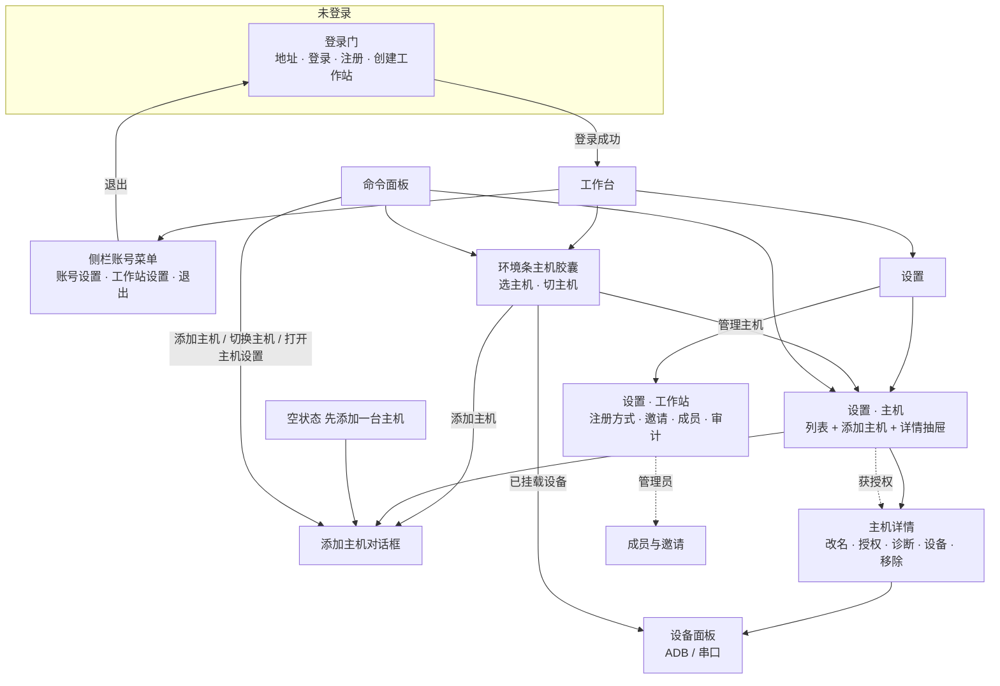

# 工作站与主机管理：信息架构重做（盘点、方案、迁移）

> 2026-11-11。一次性设计记录，看完即冻结；不改产品代码。
> 用户原话：「工作站主机管理这一块也需要重新整理设计一下。现在工作站主机就有三四个入口，并且功能都非常类似」。
> 依据：[design.md](../../design.md) P15（同一功能只有一个入口）、P09/P11/P16；[workstation.md](../../workstation.md)；[executor.md](../../features/executor.md)；[thin-host-2026-11-10.md](thin-host-2026-11-10.md) 第 9 节（工作站是服务器，远程机器只跑执行器）。
> 截图与线框：`/tmp/ia-hosts/`（`01-login-gate` … `17-mobile-account-menu`、`proposal.png`）。复现脚本 `/tmp/ia-script/shoot2.mjs`（临时工作站 + 两台主机，`TANDEM_HOME=/tmp/ia-hosts/*`，随机端口）。

## 0. 结论

1. 现状不是「三四个入口」，是 **18 处**：管理类 8 处（登录/账号 4、主机列表 3、设备 1），选择类 3 处，快捷入口 3 处，设置内「选择主机」7 处。其中 **6 处是同一功能的副本**：添加主机 5 个触发点、主机列表 2 份、两个登录界面、「添加这台电脑」两套实现。
2. 最刺眼的是**术语撞车**：侧栏账号菜单的「工作站」打开的是 **ADB / 串口设备**弹层（`WorkstationDialog`，标题也叫「工作站」），旁边「工作站管理」才是真正的工作站账号与授权页。用户点「工作站」时预期是服务器，看到的是设备列表。
3. 推荐：把对象收敛成 **工作站（服务）/ 主机（机器）/ 设备（ADB·串口）/ 成员（账号）** 四个词，按**用户任务**给五个唯一主入口：登录门、设置→主机（含添加与详情）、环境条（选主机）、设置→工作站（仅管理员）、主机详情里的设备与授权。其余位置一律降级为「跳到主入口」的快捷方式。
4. 单机个人模式（本机内嵌工作站）下界面上不出现「工作站」：登录门退化为「开始使用」，没有工作站页、没有主机切换器，主机页只有「这台电脑」。

## 1. 现状盘点

### 1.1 入口清单

| # | 入口 | 位置（file:line） | 能做什么 | 谁会用 | 问题 |
|---|---|---|---|---|---|
| 1 | 登录门（全屏） | `packages/web/src/components/auth/LoginGate.tsx:41`，挂载 `App.tsx:378` | 探测上次地址/页面地址/本机内嵌工作站；填工作站地址（`:228`「更改」`LoginGate.tsx:371`）、登录（`:271`/`:284`/`:317`）、注册（邀请码输入 `:294`）、创建工作站（名称+管理员 `:264`） | 所有人（未登录唯一入口） | 与 #2 是同一任务的两套界面；个人模式仍要看到「工作站」概念 |
| 2 | 登录对话框 | `components/accounts/LoginDialog.tsx:17`，挂载 `Sidebar.tsx:495`，入口 `Sidebar.tsx:468`（账号菜单「账号登录」） | 工作站地址 + 用户名/密码 + TOTP + 邀请码；调试账号一键登录（`:163`） | 已进入工作台但未登录（登录门关闭的调试/旧模式）、调试版 | 与 #1 重复；TOTP/邀请码字段只在一边有，行为不一致 |
| 3 | 邀请入职对话框 | `components/settings/JoinTeamDialog.tsx:14`，挂载 `App.tsx:545`，由 `HostsSection.tsx:111-117` 解析邀请链接打开 | 填名字 → 换团队成员 token → 直接添加一台主机并跳过去 | 收到旧团队邀请链接的人 | 旧「团队 Host」模型（Host 签发成员 token），与工作站账号授权并行 |
| 4 | 无主机空状态 | `components/workstation/NoHostsView.tsx:10`，`Welcome.tsx:119` | 「添加主机」→ AddHostDialog（`:48`）；「添加这台电脑」→ `lib/addLocalHost.ts:38`（`:52-63`） | 已登录、账号下没有主机的成员 | 第二个按钮是 #11 里 `joinLocal` 的另一套实现；个人用户还会同时看到新手导览卡（#15） |
| 5 | 连接主机页（旧直连） | `components/NewSessionDialog.tsx:377`（`ConnectView`），`Welcome.tsx:119`（仅登录门关闭时） | 配对链接/地址/Token/扫码直连一台 Host | 调试版、e2e、旧「地址+Token」用户 | 发布版不可达，但代码与文案仍在，术语「Token/配对链接」与一行命令并存 |
| 6 | 设置 → 主机 | `lib/settingsRegistry.ts:212`（页）、`:75-79`（设置项）；`components/settings/SettingsDialog.tsx:376` 渲染 `HostsSection.tsx:42` | 列表（在线/当前/版本不一致 `:331-354`）、添加（登录门开启→AddHostDialog `:190-200`；关闭时手填名称/地址/Token `:203-304`）、行内：诊断 `:403`、连接手机 `:414`、重连 `:421`、编辑（改名/地址/Token）`:430`、移除确认 `:535-562`；手机端按钮行 `:451-488`；扫码 `:569-578` | 所有人（成员只能管连接） | 与 #7「我的主机」两份列表；手动填表是旧模型残留；「连接手机」是旧配对 |
| 7 | 设置 → 成员与分享 → 工作站 | 导航 `lib/settingsRegistry.ts:221`（`team-shares` 页，tabs `team/accounts/shares`）；渲染 `SettingsDialog.tsx:378` → `components/workstation/WorkstationSection.tsx:37` | 账号卡（工作站名/账号/角色/地址/刷新/退出 `:112-135`）；注册与邀请（开放/仅邀请 `:147-162`、生成邀请码 `:163-178`，仅管理员）；「我的主机」列表（在线点、我的/获授权徽标、本机标、id、指纹 `:215-255`）、添加主机 `:198-205`、授权 `:244-246`、移除 `:247-250`；授权弹层 `:273-427`（账号+角色+限定目录+已有授权+撤销） | 管理员与主机主人 | 与 #6 重复出一份主机列表（字段还不一样：这里没有改名/诊断/设备；#6 没有归属/授权）；藏在「成员与分享」下，与 #8 同页并列 |
| 8 | 设置 → 成员（旧） | `lib/settingsRegistry.ts:221` tabs 内 `team`；渲染 `SettingsDialog.tsx:377` → `components/settings/TeamSection.tsx`（标题「成员」`:383`） | 生成一次性邀请链接（角色 + 项目目录 `:406-427`）、成员列表与吊销 `:471-540`、邀请记录 `:555-606`、审计 `:143` | 主机主人（旧团队模型） | 与 #7 的「账号 + 授权」是两套并行权限模型；同一个页面里两个「成员」概念 |
| 9 | 「工作站」弹层（其实是设备） | `components/workstation/WorkstationDialog.tsx:887`（标题「工作站」`:910`、描述 `:912`）；入口 `Sidebar.tsx:423`（已登录）/`:474`（未登录）、`EnvBar.tsx:992`（已挂载设备 chip）、`FeatureTour.tsx:96`、`lib/demoOpen.ts:99`；状态 `store/useDevicesStore.ts:36/71` | 跨主机 ADB / 串口列表、已挂载到当前会话列表、挂载/卸载、打开串口终端、ADB 与 serialport 安装指南 | 有设备的人 | 名字是「工作站」但内容是设备；从账号菜单进入（设备其实是会话维度）；与 #10 的「添加主机」在同一菜单里，进一步混淆 |
| 10 | 添加主机对话框 | `components/workstation/AddHostDialog.tsx:64`；触发 `NoHostsView.tsx:48`、`HostsSection.tsx:193`、`WorkstationSection.tsx:201`、`lib/commands.ts:197-208`、`tour/FeatureTour.tsx:419` | 按平台切换（`:296`）一行命令（`:370-379`）、开机自启开关（`:307`）、多网卡地址选择（`:330-344`）、令牌倒计时与重生成（`:356-368`、`:394-402`）、等待→已注册→已连接状态（`:243-259`）、「添加这台电脑」（`joinLocal :228-241`） | 所有人 | 5 个触发点没有统一入口；`joinLocal` 与 `addThisComputer`（`lib/addLocalHost.ts:38`）两套实现 |
| 11 | 环境条主机胶囊 | `components/EnvBar.tsx:782-825`（`aria-label` 切换主机/选择主机 `:789`）；菜单 `HostMenu :143-195`；新会话页 `NewSessionDialog.tsx:289-302` | 列出主机（名称、状态点、url/platform/加密隧道 detail、当前/待切换）、切换（会话内切换=导出→导入迁移 `:723-760`，先选目标文件夹 `:615-617`、`:869-884`） | 所有人（日常最高频） | 没有「添加主机」「管理主机」出口；detail 行是工程信息；来源（执行器/完整主机）不可见 |
| 12 | 侧栏筛选 → 主机 | `components/Sidebar.tsx:170-187` | 按主机筛选会话列表 | 多主机用户 | 与 #11 同名「主机」但任务不同（筛会话 vs 选执行机器），文案没有区分 |
| 13 | 顶栏主机名 / 离线条 | `components/TopBar.tsx:529`（名称）、`:549-558`（在线点）、`:659-667`（「主机未连上工作站 / 重新连接中」+ 立即重试） | 显示当前主机、重试连接 | 所有人 | 只读，无跳转；「重新连接中」与「主机未连上工作站」两种状态文案并存 |
| 14 | 命令面板 | `lib/commands.ts:197-208`（`app.add-host`）；设置项注册表 `lib/settingsRegistry.ts:75-83`；搜索输入 `components/SearchDialog.tsx:497` | 「添加主机」命令；搜「主机」出现 10 条设置项，其中 **两条都叫「添加主机」**（一条命令、一条设置）、「主机授权/我的主机」标着「设置 · 工作站」 | 键盘用户 | 同名条目、目的重复；没有「切换主机」「打开主机设置」命令 |
| 15 | 新手导览卡 | `components/tour/FeatureTour.tsx:183-190`（第 1/3 步「添加一台主机」）、`:419` | 说明 + 「添加主机」按钮（打开 AddHostDialog） | 新用户 | 与空状态 #4 同时出现两条不同样式的「添加主机」 |
| 16 | 主机诊断 | `components/DoctorDialog.tsx:129`，挂载 `App.tsx:555`；入口 `HostsSection.tsx:403/454`、`ChatView.tsx:327` | 环境检查、失败项、修复命令 | 排障用户 | 入口分散在设置与聊天页；聊天页入口在报错时才出现 |
| 17 | 连接手机（配对二维码） | `components/settings/PairDialog.tsx:13`，入口 `HostsSection.tsx:414` | 生成 `/?token=` 配对链接二维码，手机扫码直连该 Host | 旧模型用户 | 工作站模型下手机先登录工作站，这条路径已无意义 |
| 18 | 各设置页「选择主机」 | `ProfilesSection.tsx:551`（仅未登录时）、`BudgetsSection.tsx:406`、`SyncSection.tsx:266`、`McpSection.tsx:379`、`MemorySection.tsx:100`、`SecretsSection.tsx:223`、`SkillsSection.tsx:149` | 在功能内切换「配置作用在哪台主机」 | 所有人 | MCP/记忆/Skills/Secrets 是真正的按主机设置；账号与模型已在账号级后隐藏了选择器，预算与同步仍显示，是旧概念残留 |

子对话框（不算独立入口）：授权弹层（`WorkstationSection.tsx:273`）、移除确认（`HostsSection.tsx:535`）、扫码（`QrScanDialog.tsx`）、串口终端（`SerialTerminalDialog.tsx`）、串口/adb 安装指南（`WorkstationDialog.tsx:460-463`）。

### 1.2 功能 × 入口矩阵

`●` 该项是此入口的主要职责；`○` 顺带可做；`–` 不可做。列按用户面对的界面分组。

| 功能 | 登录门 | 账号菜单→账号登录（对话框） | 设置→主机 | 设置→工作站 | 设置→成员（旧） | 「工作站」设备弹层 | 添加主机对话框 | 环境条主机菜单 | 空状态 | 命令面板 | 导览卡 | 顶栏 |
|---|---|---|---|---|---|---|---|---|---|---|---|---|
| 登录 / 注册 / 创建工作站 | ● | ● | – | – | – | – | – | – | – | – | – | – |
| 填工作站地址 / 换地址 | ● | ● | – | ○（只读显示） | – | – | ○（只读显示） | – | – | – | – | – |
| 退出登录 | – | ○（菜单项） | – | ● | – | – | – | – | – | – | – | – |
| 主机列表（状态） | – | – | ● | ● | – | ○（每台一堆设备） | – | ● | ○（0 台时） | ○（跳设置） | – | ○（只当前一台） |
| 添加主机（一行命令） | – | – | ● | ● | – | – | ● | – | ● | ● | ● | – |
| 添加这台电脑 | – | – | – | – | – | – | ●（内嵌副本） | – | ●（另一实现） | – | – | – |
| 移除主机 | – | – | ● | ● | – | – | – | – | – | – | – | – |
| 改名 / 改地址 / Token | – | – | ● | – | – | – | – | – | – | – | – | – |
| 授权给成员 / 撤销 | – | – | – | ● | ○（旧成员邀请） | – | – | – | – | – | – | – |
| 成员管理（角色/吊销/邀请链接） | – | – | – | ○（只邀请码） | ● | – | – | – | – | – | – | – |
| 注册方式（开放/仅邀请） | – | – | – | ● | – | – | – | – | – | – | – | – |
| 审计 | – | – | – | – | ● | – | – | – | – | – | – | – |
| 设备（ADB/串口）挂载 | – | – | ○（连接手机入口） | – | – | ● | – | ○（已挂载 chip） | – | – | – | – |
| 设备共享给成员 | – | – | – | ○（授权主机即共享） | – | – | – | – | – | – | – | – |
| 主机诊断 | – | – | ● | – | – | – | – | – | – | – | – | – |
| 手机配对（二维码） | – | – | ●（旧） | – | – | – | – | – | – | – | – | – |
| 选主机（在哪台干活） | – | – | ○（「当前」标记） | – | – | – | – | ● | – | – | – | ○（只显示） |
| 按主机筛会话 | – | – | – | – | – | – | – | – | – | – | – | – |
| 重连 / 离线重试 | – | – | ● | – | – | – | – | – | – | – | – | ● |

矩阵里 `●` 有 3 列重叠在同一件事上：**添加主机**（设置→主机 / 设置→工作站 / 添加对话框 + 空状态 + 命令面板 + 导览卡 = 6 处）、**主机列表**（设置→主机 / 设置→工作站 = 2 份，字段不同）、**授权与成员**（工作站 / 旧成员页 = 2 套模型）。

另有两处概念性重复未进表：

- **两个登录界面**（#1 / #2），字段集不同（TOTP、邀请码、调试账号只在对话框）。
- **7 个设置页里的「选择主机」**，对账号级设置（预算、同步）已无意义。

## 2. 新信息架构（推荐方案 A）

### 2.1 五个任务与唯一主入口

| 任务 | 用户说的话 | 唯一主入口 | 其他位置只能是快捷方式 |
|---|---|---|---|
| ① 连上工作站 | 「登录 / 换账号 / 这台电脑直接开始」 | **登录门**（未登录时占据整屏，任何路由都落到这里） | 账号菜单 →「账号设置」「退出登录」「换账号」（跳回登录门） |
| ② 把一台机器加进来 | 「我要在这台机器上跑」 | **设置 → 主机 → 添加主机**（`AddHostDialog`） | 空状态主按钮、命令面板「添加主机」、环境条菜单底部「添加主机…」、导览卡——全部打开同一个对话框并记录来源 |
| ③ 在哪台机器上干活 | 「换一台机器」 | **环境条主机胶囊**（会话与新建会话页同一个组件） | 命令面板「切换主机…」、侧栏会话筛选（只筛会话，不叫「主机」而叫「按主机筛选」） |
| ④ 管理主机 | 「改名 / 移除 / 授权 / 诊断 / 设备」 | **设置 → 主机**（列表 + 行内状态）；行 → **主机详情抽屉**承接全部操作 | 顶栏主机名（点开跳详情）、离线条「查看主机」、主机菜单「管理主机…」、命令面板「打开主机设置」 |
| ⑤ 管理工作站（仅管理员） | 「谁能注册 / 邀请谁 / 谁被禁用」 | **设置 → 工作站**（独立页，不再藏在「成员与分享」下） | 账号菜单「工作站设置」（管理员可见） |

`成员（旧 TeamSection）` 与 `连接手机（PairDialog）` 在这套架构里没有位置：它们属于被工作站替代的 Host 级团队模型，随 #3 一起删除；`分享（SharesSection）` 降到主机详情的「分享链接」。

### 2.2 入口图

实线＝主入口；虚线＝仅管理员/仅获授权可见。设备面板是**会话维度**的面板（挂到当前会话），不再挂在账号菜单。

### 2.3 术语（写进 design.md 术语表）

| 概念 | 用词 | 不用 |
|---|---|---|
| 工作站服务（账号、主机登记、转发） | 工作站 | 账号中心、工作区 |
| 一台执行任务的机器 | 主机 | Host（UI 文案）、机器、服务器 |
| 主机的执行方式 | 执行器 / 完整主机（仅详情与列表徽标） | 瘦主机、远端主机 |
| ADB / 串口设备 | 设备 | 工作站（当前用法） |
| 工作站上的账号 | 账号；管理页叫「成员」 | 用户、成员（指 Host 旧成员时） |
| 选执行机器 | 选主机 / 切换主机 | 选择工作站 |

### 2.4 每个界面的内容清单（保留 / 合并 / 删除）

**登录门（`LoginGate`）**
- 保留：地址探测与「更改」、登录、注册、创建工作站（名称+管理员）、邀请码（仅 invite 模式）、调试账号（调试版）。
- 合并：`LoginDialog` 全部能力并入登录门（TOTP 字段在登录态展开为「动态验证码」，不再有两个登录界面）；个人模式下探测到本机内嵌工作站且只有创建者一个账号时，直接显示「开始使用」（名称 + 密码），隐藏地址行。
- 删除：`JoinTeamDialog`（随旧团队模型）。

**账号菜单（侧栏底部）**
- 保留：账号名 + 角色、工作站位 · 用户名副行、退出登录、（调试）用其他账号登录。
- 改：删除「工作站」（设备）项；「工作站管理」→「工作站设置」，仅 admin/owner 显示；新增「账号设置」（跳设置页的账号卡）。
- 迁移：主机相关（列表/添加/设备）全部移出账号菜单。

**设置 → 主机（唯一主机列表）**
- 保留：列表行（名称、在线点、当前、版本不一致）；行内入口（诊断、重连、编辑、移除）；添加主机 → `AddHostDialog`。
- 合并：`WorkstationSection` 的「我的主机」列表并入这里，用同一组件渲染；归属徽标（我的 / 获授权 · 角色）、本机标、最近在线、来源徽标（执行器 / 完整主机）统一在这一处；授权、移除两处只留这一份。设备入口从「连接手机」改为「设备」抽屉。`hosts.pair` 设置项删除。
- 删除：登录门关闭时的手填 名称/地址/Token 表单（`:203-304`，旧直连 e2e 走 `ConnectView` 或调试开关即可）；「加密隧道/直连」展示（工作站用户无意义，保留在详情里的技术信息区）；行内常显的 homeDir。
- 改：行点击 → 主机详情抽屉；行内只留状态与「详情 ›」，操作全部收进抽屉（P09 单行紧凑）。
- 新增：执行器主机的能力提示（不支持浏览器 / MCP / Wiki / 设备共享）只在详情里出现，不在列表重复。

**主机详情（新抽屉）**
- 内容：名称（就地改名）、状态与连接时长、来源、地址（工作站 `/h/<id>`）、版本与平台、指纹、最近在线；操作：设备（ADB/串口，含旧 `PairDialog` 的二维码只在「完整主机」显示）、诊断、授权给成员（主人）、分享链接、移除主机（确认框写清影响：主机从账号下线，执行器需重新安装/重新加入；不影响主机上的数据）。
- 保留自现有：`HostsSection` 编辑表单（改名/地址/Token）、`WorkstationSection.GrantDialog`（账号+角色+限定目录）、`DoctorDialog`、`WorkstationDialog` 的设备区、`SharesSection` 的分享链接。
- 删除：`PairDialog` 的「扫码直连」主体（仅保留完整主机的配对二维码）。

**添加主机对话框**
- 保留：平台分段、开机自启、多地址选择、一行命令、实时状态（等待→已注册→已连接）、倒计时/重新生成、「添加这台电脑」。
- 合并：`NoHostsView` 的「添加这台电脑」与对话框共用 `addThisComputer`；删除对话框内 `joinLocal` 副本（`:228-241`）。
- 新增：标题下方一行说明「目标机器只装执行器；会话与模型在工作站」（P16 一句话讲清边界）；打开来源记录（`source=empty|settings|palette|envbar|tour`）只用于埋点，不显示。

**环境条主机胶囊**
- 保留：当前主机名 + 状态点、切换主机（会话内迁移 + 待选文件夹）、取消切换。
- 改：菜单只显示 名称 + 状态 + 来源徽标；底部固定两项「管理主机…」（跳设置→主机）与「添加主机…」（打开对话框）；切到执行器主机时在待切换提示里说明「执行器主机不支持浏览器预览、MCP、设备（如已挂载会断开）」。
- 删除：菜单里的 url / platform / 加密隧道 detail 行（P11 辅助信息默认隐藏）。

**设备面板（原 `WorkstationDialog`）**
- 改：标题「设备」，描述改为「所有主机的 ADB / 串口设备」；入口：环境条已挂载设备 chip、主机详情「设备」、会话右侧面板。
- 保留：已挂载列表、按主机分组、挂载/卸载、串口终端、安装指南。
- 删除：账号菜单入口；「工作站」名称。

**设置 → 工作站（管理员）**
- 保留：工作站名、地址、刷新；注册方式；生成邀请码；审计（从旧成员页迁入）。
- 合并：成员列表（账号名、用户名、角色、最近登录、调试标；禁用/启用）用 `GET /api/workstation/overview`（已返回 accounts）+ 新增 `PATCH /api/workstation/accounts/:id`；邀请记录（旧 `TeamSection` 的 invites）放在成员下方折叠区。
- 删除：这一页不再列出「我的主机」（去设置→主机）；旧「成员」tab 整个删除；`SharesSection` 从这一页移出（分享属于主机）。
- 成员视角：同页只显示自己的账号卡（角色、地址、退出登录），注册与邀请/成员列表不渲染（当前已按 admin/owner 判断，保留）。

**成员与分享页**
- 删除 `成员` tab（旧 Host 团队模型：邀请链接、成员 token、吊销）。
- `分享` 保留为独立设置页或并入主机详情；不保留「团队与共享」这个分组名下的两套成员概念。

**命令面板 / 设置项注册表**
- 命令保留一条「添加主机」；新增「切换主机…」「打开主机设置」。
- 设置项删除 `accounts.members`（主机授权）与 `accounts.hosts`（我的主机），并入 `hosts.*`；`hosts.pair` 删除；同名「添加主机」不再出现两次（命令与设置项标题区分：命令「添加主机…」，设置项「主机列表」「主机详情」）。

**单机个人模式（本机内嵌工作站）**
- 判定：工作站为内嵌实例，且只有创建者一个账号（无其他成员、无授权）。服务端在 `WorkspaceStatus` 增加 `personal: boolean` 下发。
- 界面：登录门 →「开始使用」一步完成；账号菜单只有「账号设置 / 退出登录」；不显示「工作站设置」；设置 → 主机只有一台「这台电脑」（名称可改），环境条主机胶囊变成静态机器名标签（不弹菜单）；主机详情只留改名、诊断、设备、移除（移除＝退出本机使用，确认文案写明「账号与工作站保留，可随时重新添加」）；命令面板不出现「切换主机」。
- 团队化：首次加入别的工作站或新增第二个账号后，`personal` 失效，所有入口恢复正常；不提供手动开关。

### 2.5 备选方案 B（不推荐）

把「主机」和「工作站」合成一个设置页「连接」：上半是工作站（账号、注册、邀请、成员），下半是主机列表与详情，登录门保持不变。

- 优点：导航只剩一项，最贴近「一个服务管所有机器」的心智。
- 为什么不选：管理员任务（注册策略、禁用成员）与日常任务（切主机、加主机）混在一页，普通成员进入会看到无权区域或空区域；主机数量多时工作站配置被挤到顶部；与 P15「设置按固定分组」冲突。留作如果用户更偏好「一个页面看全部」时的备选。

### 2.6 线框图

`/tmp/ia-hosts/proposal.png`：A 主界面（账号菜单只剩账号；环境条主机胶囊 + 菜单底部两项快捷方式；设备 chip）；B 设置 → 主机（来源徽标、归属徽标、详情抽屉）。

## 3. 迁移与实施拆分

每项可独立交付、单独发布；顺序即建议顺序。验收写的是「能点到、能看到」的行为，能自动化的进 `e2e/regression.mjs` 或 `scripts/decisions-check.mjs`。

**T1 术语与去歧义（纯前端，1 个提交）**
- 改名：`WorkstationDialog` 标题与描述 →「设备」；账号菜单「工作站」项移除、入口改到环境条已挂载 chip 与主机页行内；「工作站管理」→「工作站设置」（admin/owner 才显示）。
- 验收：登录后账号菜单只有 账号设置 / 工作站设置（管理员）/ 退出登录；点环境条已挂载设备 chip 打开「设备」；全产品（含手机）搜不到「工作站」指代设备的文案。检查：`ui-audit` 加「账号菜单不含设备入口」断言；回归更新「工作站设备」用例选择器。

**T2 主机列表合并（前端 + 组件复用）**
- `WorkstationSection` 的「我的主机」改用新 `HostList` 组件（从 `HostsSection` 提出），两处渲染同一份数据；删除 `WorkstationSection` 里的列表与移除按钮；设置项 `accounts.hosts` 删除。
- 验收：设置 → 主机 显示我的 + 获授权主机，带 我的/获授权 徽标；设置 → 工作站 不再出现主机列表；命令面板「主机」结果无同名重复项。检查：回归加「主机列表只出现一次」。

**T3 主机详情抽屉（前端）**
- 新组件 `HostDetailDrawer`：承载改名、移除、授权、诊断、设备、分享、最近在线、来源徽标、执行器能力提示；`HostsSection` 行内操作收进抽屉（行只留状态 + 详情）。
- 验收：点任意主机行打开抽屉；改名后列表立即更新；移除需二次确认且文案含影响范围；键盘 Tab 可达全部操作、Esc 关闭；手机抽屉全屏。

**T4 添加主机唯一化（前端）**
- `NoHostsView`、命令面板、环境条菜单、导览卡、主机页全部调用同一个 `AddHostDialog`；`AddHostDialog` 内 `joinLocal` 改为调用 `addThisComputer`；删除重复实现。
- 验收：5 个入口打开同一对话框（同一标题、同一状态机）；「添加这台电脑」在空状态与对话框里都能成功且只登记一台主机；令牌过期后两处表现一致。

**T5 工作站页拆分与成员管理（前后端）**
- 新页 `SettingsTab = 'workstation'`（导航「基础」组，紧跟主机）；`WorkstationSection` 只留工作站信息、注册与邀请、成员、审计；`TeamSection` 与 `JoinTeamDialog` 删除；`SharesSection` 移到主机详情。
- 后端：`PATCH /api/workstation/accounts/:id { disabled }`（复用 `store.updateAccount`），协议先加类型；`GET /api/workstation/overview` 已有 accounts。
- 验收：管理员在成员列表禁用某账号 → 该账号下一次请求 401，且主机侧授权快照失效；非管理员看不到成员列表；旧团队邀请链接提示「该功能已移到工作站邀请码」。

**T6 个人模式简化（前端 + 协议 + 服务端）**
- 协议 `WorkspaceStatus.personal`；服务端计算（内嵌 + 单账号）；UI 按 §2.4 隐藏工作站页/主机切换/切换主机命令，登录门「开始使用」。
- 验收：内嵌单账号下界面无「工作站」字样（登录门那一行地址除外）；移除「这台电脑」后可从空状态重新添加且账号保留；加入第二台主机或第二个账号后入口恢复。

**T7 环境条与命令面板收尾（前端 + 检查）**
- 主机菜单精简为 名称+状态+来源，底部「管理主机…」「添加主机…」；新增命令「切换主机…」「打开主机设置」；侧栏筛选文案改「按主机筛选」；预算、同步页删除「选择主机」（账号级）。
- 验收：主机菜单只有两项固定快捷方式；会话内切换主机仍走「待选文件夹」流程；`decisions-check` 新增：①账号菜单无主机/设备项 ②设置导航「主机」「工作站」各一个 ③命令面板无同名命令 ④设置页只有 MCP/记忆/Skills/Secrets 有主机选择器。

## 4. 风险与未决（需产品确认，不自行决定）

1. **旧 TeamSection / JoinTeamDialog 删除时机**：涉及已发出的团队邀请链接与旧成员 token（主机端验签仍兼容）。建议 T5 与「旧完整 Host 远程路径」一起在 M6 删除；在此之前只隐藏入口。
2. **「分享」归属**：现在在「成员与分享」页，本方案移到主机详情。若用户希望分享仍是独立设置页，T5 只移入口不改页面。
3. **执行器 vs 完整主机的可见度**：客户端目前拿不到 `remote` 标志（`HostInfo` 无该字段），来源徽标与能力提示需要协议加 `kind`；不加则 T3 的「来源」「不支持能力」两条无法交付。
4. **成员禁用后的会话**：禁用账号时是否立即断开其在跑会话（现在是令牌失效，已连接 WS 可能存活到下一请求）。需要产品定行为。
5. **个人模式判定**：以「内嵌 + 单账号」为准是否足够（例如同一台机器用两个账号登录就会恢复完整界面）。若用户希望显式「仅本机使用」开关，需另加设置项。

## 用户决定（2026-11-11 16:42）

原话："你发给我的截图只是一个示意图吗？不会改到我的UI吧？……如果说只是示意图的话，我觉得差不多就可以这样。然后完全没有必要出现一个仅本机使用，就是没有必要出现本机一个人用这种概念。整个程序就是一个跑在服务器上的工作站，它就是一个服务。我们打开它就是用一个客户端去连接它，然后呢，它可以跟各个主机建立会话连接，然后我们可以在各个主机上去跑agent。……设备也不仅仅只有ADB和串口，可能还有更多的。另外团队那些东西，其实直接可以就删了。我们现在始终是在内测。不用考虑兼容性，该删的就直接删。不要搞出新旧两个东西同时存在。没有迁移约束"

1. 线框图只表达信息架构（入口归属），不改现有视觉；实施时沿用现有组件与样式，只移动/合并入口与字段。
2. 取消 T6「个人模式」：没有"本机一个人用"的概念。产品模型统一为：工作站是服务；客户端连接工作站；工作站与各主机建立连接；在主机上跑 agent。
3. 设备是开放概念（ADB、串口只是当前两种），命名与界面不得写死为 ADB/串口。
4. 团队（旧 TeamSection / JoinTeamDialog / 成员 token / 团队邀请）直接删除；内测阶段不考虑兼容与迁移，旧东西直接删，不保留新旧并存。第 4 节未决项 1 据此关闭。
