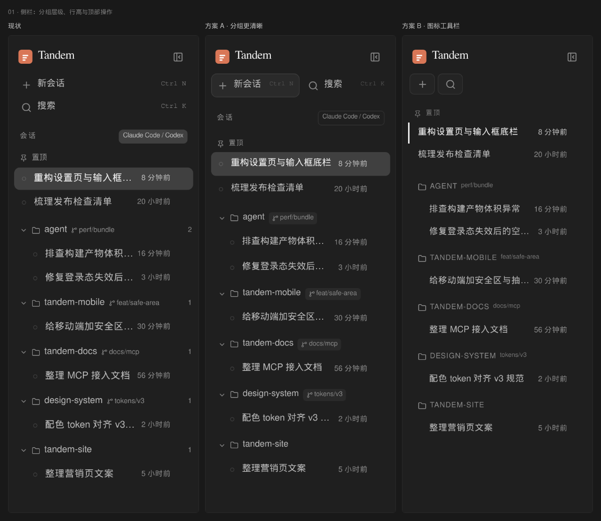
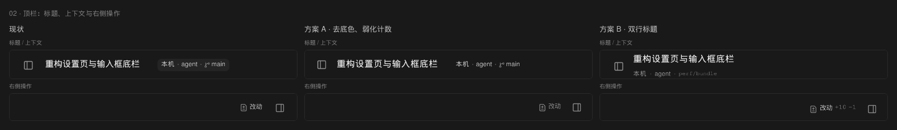
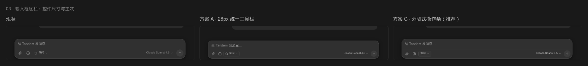
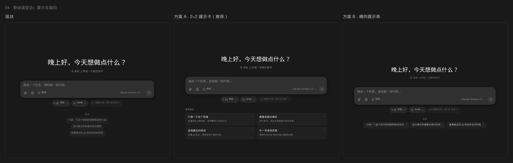
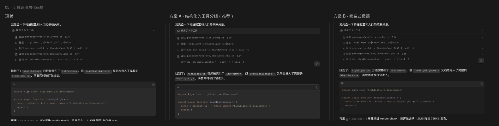
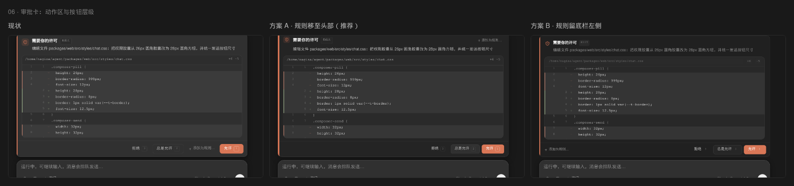
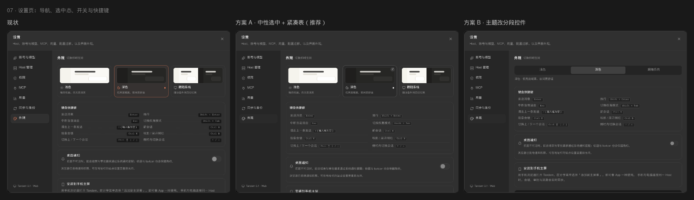
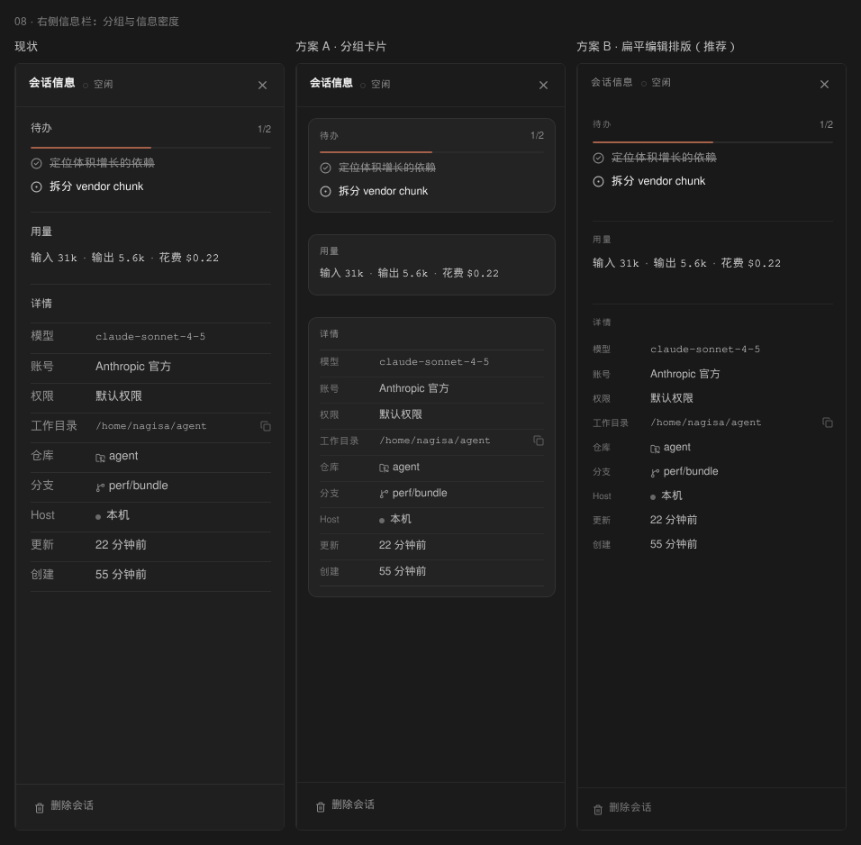
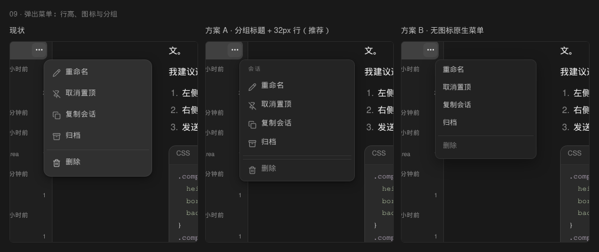

# Tandem UI 打分卡

深色模式、1440×900，基于当前代码构建的真实界面（假数据：2 个账号、8 个会话、Markdown/代码/工具调用/thinking/错误/待审批）。截图区域按 2× 缩放，拼图统一 1600px 以内、`#191919` 背景。未修改 `packages/` 下任何文件。

**怎么用**：每节先看「问题」，再给各方案打分（1–5，5 = 最该改），最后看我的推荐与实现备注。分数可以直接写在表格里或回复我编号。

## 总表

| # | 区域 | 我认为的问题度 | 你的评分（1–5） | 我的推荐 |
|---|---|---|---|---|
| 01 | 侧栏：分组层级、行高、顶部操作 | 4 |  | A |
| 02 | 顶栏：标题、上下文、右侧操作 | 3 |  | A |
| 03 | 输入框底栏：控件尺寸与主次 | 5 |  | C |
| 04 | 新会话空态：提示与留白 | 4 |  | A |
| 05 | 工具调用与代码块 | 3 |  | A |
| 06 | 审批卡：动作区与按钮层级 | 4 |  | A |
| 07 | 设置页：导航、选中态、开关、快捷键 | 3 |  | A |
| 08 | 右侧信息栏：分组与密度 | 3 |  | B |
| 09 | 弹出菜单：行高、图标、分组 | 2 |  | A |

一个跨页面的总判断：现在按钮的问题不是单个按钮「丑」，而是**没有一套尺寸/圆角/层级规则**：28 / 30 / 32 / 36 / 44 都在出现，圆角 6 / 7 / 8 / 12 / 20 混用；主按钮有时是橙色、有时是中性；图标按钮 hover 有的变底色、有的只变字色。建议先定 3 个尺寸 token：`28`（密集工具/菜单）、`32`（常规按钮/图标）、`36`（对话框主操作），组件不再各写各的。

---

## 01 侧栏：分组层级、行高与顶部操作

**位置**：左侧栏 272px，顶部操作、置顶区、项目分组、会话行。

**问题**：会话行 44px 高，项目组头却只有 32px；项目名和分支挤在同一行，右侧的 1/2 计数像表格列；顶部「新会话 / 搜索」和普通会话行完全同级，主操作没有重量。置顶区又缺少项目上下文，一眼看不出它属于哪个仓库。

- **方案 A（推荐）· 分组更清晰**：顶部「新会话」改为 34px 实底主行，搜索保持幽灵；组头 30px、分支变成 9.5px 圆角 chip、去掉计数；会话行降到 34px，选中用 `--t-bg-active` 圆角 7。信息层级更接近 Linear。
- **方案 B · 图标工具栏**：新会话/搜索收成两个 36px 图标按钮并排；项目头改为 10.5px 大写小标题；会话 30px、选中只留 2px 左侧竖线、不铺底色。最安静，但牺牲了文字可发现性。

**我的推荐**：A。它保留了「新会话」的文字入口和项目图标，只把尺寸与分组关系理顺；B 更适合以后做「侧栏极简模式」开关。

---

## 02 顶栏：标题、上下文与右侧操作

**位置**：48px 顶栏，标题、Host·项目·分支胶囊、状态、改动审阅、右侧面板开关。

**问题**：标题 + 三段上下文塞进一个 10.5px 的灰底胶囊，像禁用标签；右侧「改动」28px、面板按钮 36px，尺寸与颜色都不齐；diff 统计仍用 `success/danger` 语义类，虽然 token 已中性化，代码层还在表达红绿。

- **方案 A（推荐）· 去底色、弱化计数**：元信息改为无底色 10.5px 次要文字，用 `·` 分隔；标题 14.5px；右侧操作统一到 30px 幽灵按钮；diff 两个数字都用 `--text-tertiary`。改动最小，立刻少一块灰色。
- **方案 B · 双行标题**：标题 14.5px 在上、10.5px 面包屑在下，去掉胶囊；顶栏高度 52–54px，状态点与两行垂直居中。上下文更清楚，但要改 TopBar 的布局与 48px 规范，属于结构性方案。

**我的推荐**：A。先解决「灰胶囊 + 按钮不齐」，成本低、气质提升明显；如果之后愿意把顶栏加到 52px，再做 B。

---

## 03 输入框底栏：控件尺寸与主次

**位置**：输入框卡片底部工具栏：附件、思考模式、权限模式、模型、发送。

**问题**：权限胶囊 26px 夹在一排 32px 图标与按钮之间，既没有边框也没有底色，看起来像一段会动的图标文字；模型名 12.5px 与 32px 发送按钮重心不齐；左侧三个控件 hover 只变字色，没有统一的触感。整条底栏的控件高度至少三档。

- **方案 A · 28px 统一工具栏**：图标、权限胶囊、模型、发送全部压到 28px；权限胶囊 24px 高、6 圆角、1px 边框；底栏内边距 2/8/7；卡片圆角 18。最紧凑。
- **方案 C（推荐）· 分隔式操作条**：控件统一 30px；权限胶囊 26px、去掉盾牌图标只留「询问」；底栏顶部加 1px 内部分隔线，把输入区与操作区分开；模型 30px、发送 30px，hover 用 `#3a3a3a` 实底。

**我的推荐**：C。它同时解决「高度不齐」和「底栏没有结构」；分隔线让底部工具条不再像散落的图标。A 更紧凑，但少了结构提示。

---

## 04 新会话空态：提示与留白

**位置**：新会话页（侧栏「新会话」/ Ctrl N），问候、输入框、Host/目录/worktree 胶囊、`试试` 提示。

**问题**：680px 输入框下面挂三颗 11.5px 的提示胶囊，像标签而不是可点击的建议；`试试` 小标题与提示文字都弱，页面下半屏几乎全空，第一眼不知道下一步能做什么。

- **方案 A（推荐）· 2×2 提示卡**：输入框放宽到 720px，提示区变成两列四张卡片，每张标题 12.5px + 说明 10.5px + 右上箭头；`常用提示` 做成 10px 小标题。空态从「标签云」变成真正的入口。
- **方案 B · 横向提示条**：保留三颗提示，但改成 30px 高一排、圆角 8、带箭头，标签「常用」居中；整体更克制，页面仍偏空但更安静。

**我的推荐**：A。新会话是第一次打开产品时看到最多的页面，值得用四张卡把「能做什么」说清楚；B 适合以后做「低干扰空态」偏好。

---

## 05 工具调用与代码块

**位置**：对话中的「使用了 5 个工具」分组、展开后的工具行，以及 fenced code block。

**问题**：工具分组头（hover/展开时）是一条 28px 的整宽灰底，像被选中的列表行；工具行之间没有分隔，chevron 只有 hover 才出现；代码块头只有左侧一个 11.5px 的 `ts`，复制图标几乎不可见，代码块也没有边界，和正文挤在一起。

- **方案 A（推荐）· 结构化分组**：分组头 32px、1px 边框、8 圆角、12px 文字；工具行 30px、去掉左侧贯穿竖线、用 `inset 0 1px` 细分隔；代码块加 1px 边框 + 10 圆角，头 32px 用 `--t-surface-2`，语言 10px 上标，复制按钮 22px。
- **方案 B · 终端式极简**：分组头改成 30px、下边 hairline、10.5px 大写；展开内容保留 1px 左竖线；工具行 27px；代码块无边框、用 `#1e1e1e` 底，头 28px。最像 Claude Code / 终端，信息密度最高。

**我的推荐**：A。它保留 13px 的可读性和 Tandem 的卡片语言；B 很酷，但把中文工具名压到 10.5px 会牺牲可扫读性。

---

## 06 审批卡：动作区与按钮层级

**位置**：输入框上方的待审批卡片（Bash/Edit 预览、底部四颗按钮）。

**问题**：底栏四颗动作并排：拒绝（幽灵）、总是允许（有边框）、添加为规则（幽灵 + 加号）、允许（橙色）。「添加为规则」夹在两个决策之间，既不是决策也不是纯链接；按钮 30–32px、Kbd 18px，圆角与字号都各写一套，视觉重心最后落在橙色块上，但橙色块的宽度又比其它按钮大不了多少。

- **方案 A（推荐）· 规则移至头部**：`添加为规则…` 变成头部右侧的 11px 文字链接，底栏只留「拒绝 / 总是允许 / 允许」三颗 30px 按钮；允许 30px、拒绝幽灵、总是允许 1px 边框；卡片 14 圆角、左侧 2px 橙条，Kbd 缩到 16px。
- **方案 B · 规则留底栏左侧**：底栏 `justify-content: space-between`，左侧规则链接、右侧决策组；头部去掉橙色图标底，只留 15px 盾牌；卡面更平，按钮仍是 30px。决策组更突出，但底栏信息更满。

**我的推荐**：A。把「安全规则」从即时决策里拿出去，三颗按钮的主次一眼可读；B 更平衡，但底部仍有四个可点目标。

---

## 07 设置页：导航、选中态、开关与快捷键

**位置**：设置对话框左侧导航、外观页主题卡、快捷键表、桌面通知开关。

**问题**：选中主题卡同时用了橙边框、橙色 ring、橙点、橙图标（设计规范里橙只用于品牌/发送/焦点/待审批）；导航选中项也是橙图标 + 实底 + ring + 阴影，四层装饰；快捷键表的虚线引导线像 Word 目录，kbd 10px 偏小；关闭状态的通知开关几乎看不见。

- **方案 A（推荐）· 中性选中 + 紧凑表**：选中卡改 1px `#5a5a5a` 边框 + `--t-surface-2` 底 + 右上 16px 勾选圈，去掉橙 ring/dot/icon；导航选中只留 `#2a2a2a` 底，无 ring/阴影、图标中性；快捷键行 28px、去掉虚线、kbd 9.5px 用 `#242424` 底；开关轨道 `#3a3a3a`、滑块近白。
- **方案 B · 主题改分段控件**：三张缩略图卡换成 36px 的三段控件（浅色 / 深色 / 跟随系统），选中 `#404040`；下方保留一句说明；通知开关 34×20 中性；导航同 A。页面更短更整齐，但失去主题预览。

**我的推荐**：A。保留缩略图的直觉，同时把橙色收回规范用途；快捷键表会明显更干净。B 可以作为空间不足时的备选。

---

## 08 右侧信息栏：分组与信息密度

**位置**：会话信息面板（待办、用量、详情、删除会话）。

**问题**：每个 section 用整条 hairline 分隔，详情表每一行也都有线，标签与值同为 13px；待办、用量、详情三块权重一样，视线没有落点；工作目录和模型的长字符串在 60px 标签列旁边显得挤，删除会话孤零零贴在底部。

- **方案 A · 分组卡片**：待办/用量/详情各自变成 `#232323` + 1px 边框 + 10 圆角的卡片，段标题 10px 大写；详情行 54px 标签列、4px 行距；删除会话 hover 转 `--danger`。
- **方案 B（推荐）· 扁平编辑排版**：不加卡片，只去掉详情行的横线；section 用 9.5px 大写标题 + 1px 顶线；标签 10px、值 12px；用量保持一行；信息直接从「表格」变成「排版」。更安静，也更像 Claude Code Desktop 的右栏。

**我的推荐**：B。右栏是辅助信息，不需要三张卡片再增加边界；B 的密度与留白刚刚好。

---

## 09 弹出菜单：行高、图标与分组

**位置**：侧栏会话行右侧「⋯」弹出的菜单（重命名 / 置顶 / 复制 / 归档 / 删除）。

**问题**：184px 宽、36px 行高、14px 图标，信息密度低；没有分组，删除与其它项只隔一条 hairline；图标颜色与文字几乎同亮，菜单看起来比它承载的功能更重。

- **方案 A（推荐）· 分组标题 + 32px 行**：菜单 196px、顶部加 9.5px「会话」小标题；条目 32px、6 圆角、图标 14px 降到 `--text-tertiary`；删除前留 5px + 1px 分隔，hover 才转 `--danger`。
- **方案 B · 无图标原生菜单**：172px 宽、30px 行高、去掉图标，纯文字 + 5px 圆角；删除降到 `--text-tertiary`。像系统右键菜单，最安静，但识别速度略慢。

**我的推荐**：A。菜单是高频操作，保留图标 + 加一个极小的分组标题，能明显提升「这是一组会话语义操作」的感觉；B 太素，和 Tandem 的产品气质偏冷。

---

# 实现备注（供后续落地）

> 以下都是「改哪个文件 / 改哪些类或 token」，不是代码补丁。所有方案均未修改产品源码。颜色继续沿用 `--t-*` 变量，避免新增硬编码。

## 01 侧栏

**A**
- `packages/web/src/components/Sidebar.tsx`：顶部两行 `row` 改为 34px；第一个按钮（新会话）加 `bg-[var(--t-surface-2)]` + `border border-border` + `rounded-lg`，搜索保持透明；`kbd` 9.5px、opacity .55。
- `SessionList.tsx`：项目组头 `min-h-8` 保持 30px；分支 `span` 改为 `bg-[var(--t-surface-2)] px-1.5 py-px rounded text-[9.5px]`，去掉组头右侧计数 `w-5`（或降到 opacity .5）。
- 会话行 `min-h-11` → 桌面 `md:min-h-[34px]`（移动端保留 44）；选中行用 `bg-[var(--t-bg-active)] rounded-[7px]`，文字 `--text`。
- 置顶小标题 10px、字距 .08em；组头与第一条会话间距 4px。
- 需要保留移动端 44px 触控目标，不要把 34px 应用到 `<768px`。

**B**
- 顶部 `div.px-2` 改为 `flex gap-1`；两个按钮各 36×30、只留图标；`span`/`kbd` 桌面 `hidden`，用 `aria-label`/`title` 兜底。
- 项目组头 28px、10.5px 大写、隐藏 folder 图标（或只保留 chevron）；分支 9px。
- 会话行 30px、`rounded-none`、`pl-3.5`；选中 `box-shadow: inset 2px 0 0 var(--t-text)`，不铺底色；idle 状态点隐藏（保留 running/approval）。
- 顶部「会话 + Claude Code / Codex」筛选条在 B 中隐藏，需把来源筛选移到侧栏底部的 Popover，不能直接砍功能。

## 02 顶栏

**A**
- `TopBar.tsx`：元信息 span 去掉 `bg-[var(--t-bg-hover)]` 与 `px-1.5 py-0.5`，改 `text-[10.5px] text-[var(--t-text-tertiary)] gap-1`；分隔符仍用 `·`。
- 标题 `text-[14.5px] font-[550]`；改动按钮 `h-7`、字号 10.5；面板/侧栏按钮统一 `size-[30px]`；hover 只在操作按钮上加 `--bg-hover`。
- diff 数字不再用 `.text-success/.text-danger`，改 `text-[var(--t-text-tertiary)]`（或同色 mono），避免代码层继续表达红绿。
- 顶栏底边 hairline 目前只有滚动后出现，保持这个行为；A 的截图里加了静态线只是为了看清区域。

**B**
- `TopBar.tsx` 需要把「标题按钮 + 面包屑 + 状态」包成两行 grid（`grid-template-rows: auto auto`），标题 14.5/19，面包屑 10.5/14；隐藏现有元信息 pill。
- 顶栏高度 52–54px，需同步 `ChatView` 的顶部 padding、移动端标题与 `desktop-drag` 区域；状态 pill 跨两行居中。
- 分支用 `font-mono text-[9.5px]`，Host/项目用正文字体；这是结构性改动，建议单独 PR。

## 03 输入框底栏

**A**
- `Composer.tsx`：`.composer-icon-btn` 28×28、radius 6；`.composer-pill` 24px、radius 6、`border 1px solid var(--t-border)`、font 11.5；模型按钮 `md:h-8` 已存在，A 中改为 `h-7`（28）；`.composer-send` 28×28。
- 底栏容器 `padding: 2px 8px 7px`、gap 2；`.composer-card` radius 18；textarea 15px。
- 移动端 <768 继续 44px 触控，用媒体查询覆盖。

**C（推荐）**
- `.composer-icon-btn` 30×30、radius 7、hover `#3a3a3a`；`.composer-pill` 26px、radius 7、1px 边框、去掉 shield 图标（`Composer.tsx` 中 Icon 可条件隐藏），只留「询问/自动接受/计划」+ chevron。
- 模型按钮 30px、font 11.5；`.composer-send` 30×30；底栏顶部 `border-top: 1px solid rgba(255,255,255,.055)`、`padding: 5px 8px 6px`、`margin-top: 2px`。
- `Composer.tsx` 底部容器加 `composer-footer` 类，避免继续用 `div.flex.items-center` 临时选择器；移动端 44px 目标单独覆盖。

## 04 新会话

**A**
- `NewSessionDialog.tsx`：容器 `max-w-[680px]` → 720；`HINTS` 从单列胶囊改为 2×2 卡片，卡片 64px、`--t-surface` 或 `#202020`、1px 边框、10 圆角；标题 12.5、说明 10.5、右上 ↗。
- 问候 h1 `30px`、说明 12px；「常用提示」10px 大写、字距 .1em，左对齐；卡片 hover `border-strong` + `--bg-hover`。
- 卡片点击仍走 `seedPrompt`，不新增接口。

**B**
- 保留 `HINTS` 数据，渲染容器改成 `flex-row` 横向、`button` 30px 高、radius 8、11.5px，箭头用伪元素；`试试` 改为 `常用` 10px 居中。
- 容器 `max-w-[720px]`；移动端允许横向滚动（已有 `no-scrollbar`）并保留 44px 高。

## 05 工具与代码块

**A**
- `ToolGroup.tsx` 的组头：`min-h-[32px] px-2 border border-border rounded-lg bg-[var(--t-surface-2)] text-[12px]`；chevron 常显 65%。
- `ToolGroup.tsx` 展开内层去掉 `border-l`，`pl-0`；`ToolCard.tsx` 的行 `min-h-[30px]`，用 `box-shadow: inset 0 1px 0 rgba(255,255,255,.05)` 做分隔；图标 13。
- `CodeBlock.tsx`/`chat.css`：`.chat-code` 加 `border 1px` + `border-radius 10` + `overflow:hidden`；`.chat-code-head` 32px、`background: var(--t-surface-2)`、语言 10px；复制按钮 22px；`pre` 12.5px。
- `chat.css` 现有 `.tool-row` 与 `.tool-chevron` 的 hover 规则需要同步调整，避免和新的常显 chevron 冲突。

**B**
- 组头 `min-h-[30px]`、下边 1px、无圆角/底，10.5px 大写；展开内层保留 `border-l` + `pl-2`；工具行 27px。
- `.chat-code` 去边框、`background:#1e1e1e`、radius 8；头 28px、语言 9.5px 大写；复制按钮 20px；`pre` 12.5px。
- 工具行图标 12px、opacity .75；需要补一条「展开行 hover 才显示 chevron」的规则，避免 B 截图里所有箭头常显造成噪音。

## 06 审批卡

**A**
- `PermissionCard.tsx`：把「添加为规则…」按钮从 footer 移到标题行（`flex flex-wrap` 容器），`ml-auto`、24px 高、11px、`text-muted`；footer 只保留三颗按钮。
- `.permission-card`：radius 14、1px 边框、`border-left: 2px solid var(--t-accent)`；header padding 13/16/9；description 12.5、`--text-soft`。
- footer `padding:10px 14px`、`gap:6px`、右对齐、顶部 hairline；按钮 30px、radius 7、12px；主按钮 `padding:0 14px`；`Kbd` 16px。
- `Kbd` 组件的边框/字号在 A 中需要接受 `size` prop，避免每个位置写死 18px。

**B**
- footer 改为 `justify-content: space-between`；用 DOM 分组包住三颗决策按钮（`v-acts` 概念），规则按钮留在左；按钮 30px，允许橙色，其它中性。
- header 去掉图标 tinted 底，只留 15px 盾牌；标签 9.5px 大写；卡片 radius 12、无阴影；Kbd 15px、无边框。
- 需要在 `PermissionCard.tsx` 里真实包一层 `.permission-actions`，不要只靠 CSS 选择器去猜按钮顺序。

## 07 设置页

**A**
- `AppearanceSection.tsx`：主题卡选中态改为 `border-[#5a5a5a] bg-[var(--t-surface-2)]`，删除 `ring-accent/30`、`border-accent/45`、橙点与橙色图标；加右上 16px 勾选圈（`#404040` 底 + 白勾），`aria-pressed` 保留。
- 通知开关：checked 时也不再 `bg-accent`，用 `bg-[#8a8a8a]` 或 `bg-[var(--t-bg-active)]`；轨道 `#3a3a3a`、滑块 `#efefef`，宽高 36×20（或保留 40×24，但统一）。
- `SettingsDialog.tsx` 导航选中：`bg-[var(--t-bg-active)]`、去掉 ring/阴影、图标 `--text-secondary`；字号 12。
- 快捷键表：行 28px、去掉 `border-b border-dashed`，label 后直接跟 kbd；kbd 9.5px、`bg-[#242424] border-[#444]`；移动端保留两列。

**B**
- 删除三张主题卡，改为 `grid grid-cols-3 gap-[3px] p-[3px] rounded-[9px] bg-[#242424] border`，按钮 30px、选中 `#404040`；下方 11px 说明保留。
- 开关同 A；导航同 A；快捷键用 A 的紧凑行。
- 会失去 `ThemePreview` 组件；如果以后还想要预览，可以在分段控件 hover/focus 时弹一个小 preview，或保留在「外观」以外的「关于」页。

## 08 右侧信息栏

**A**
- `RightPanel.tsx` 滚动容器：`gap:8px`，每个 `<section>` 加 `bg-[#232323] border border-border rounded-[10px] p-3`；section 标题 10px 大写、`--text-tertiary`。
- `DetailRow` grid `54px minmax(0,1fr)`、`padding:4px 0`、标签 10.5px；`divide-y` 线降到 `rgba(255,255,255,.045)`；删除按钮 34px、hover 才转 danger。
- 需要在 `RightPanel` 里把「待办/用量/详情」的 `<section>` 直接加类，不要只靠 `section` 标签选择器。

**B（推荐）**
- 滚动容器 `padding:14px 16px`；section `border-top:1px solid var(--t-border)`、`padding:14px 0 16px`，第一段去顶线；标题 9.5px 大写、字距 .1em。
- 详情去掉 `divide-y` 与 `border-y`，行 `padding:3px 0`，标签 10px；`DetailRow` 仍保留 52px 列宽。用量保持单行，待办进度条 2px 保留。
- header 44px、标题 11px 大写；底栏删除 32px、hover 才 danger；这是纯样式改动，推荐先做。

## 09 弹出菜单

**A**
- `SessionList.tsx` 的 `RowMenu`：菜单宽 196px、padding 5px、radius 10；顶部插入 9.5px「会话」分组标题；条目 `min-h-8`（32）、radius 6、gap 8、图标 14px `--text-tertiary`。
- 删除条目：`margin-top:5px; border-top:1px solid var(--t-border);`，默认 `--text-tertiary`，hover 才 `--danger`。
- 需要把菜单项的 `text-[12.5px]` 提高到 13px，并把 `aria-label`/role 补齐；现有 `role=menu` 保留。

**B**
- 菜单 172px、padding 4、radius 9；条目 30px、radius 5、font 12、`gap:0`；`svg` 隐藏；背景 `#222`，hover `#333`；删除默认 `--text-tertiary`。
- 无图标后必须保留可访问名（aria-label）；如有键盘导航，右箭头/快捷键可后续加。

---

### 最后

如果只先做三件事：**03 输入框底栏（C）→ 06 审批卡（A）→ 01 侧栏（A）**。这三处每天都在被点，改动集中在 CSS 与少量 JSX，风险比动顶栏/设置页布局低。做完后再统一按钮 token，剩下的 06/07/08/09 基本都是把尺寸和颜色收回 token 的工作。

图片清单：

- `/tmp/tandem-scorecard/01-侧栏.png`
- `/tmp/tandem-scorecard/02-顶栏.png`
- `/tmp/tandem-scorecard/03-输入框底栏.png`
- `/tmp/tandem-scorecard/04-新会话空态.png`
- `/tmp/tandem-scorecard/05-工具与代码块.png`
- `/tmp/tandem-scorecard/06-审批卡.png`
- `/tmp/tandem-scorecard/07-设置页.png`
- `/tmp/tandem-scorecard/08-右侧信息栏.png`
- `/tmp/tandem-scorecard/09-弹出菜单.png`
