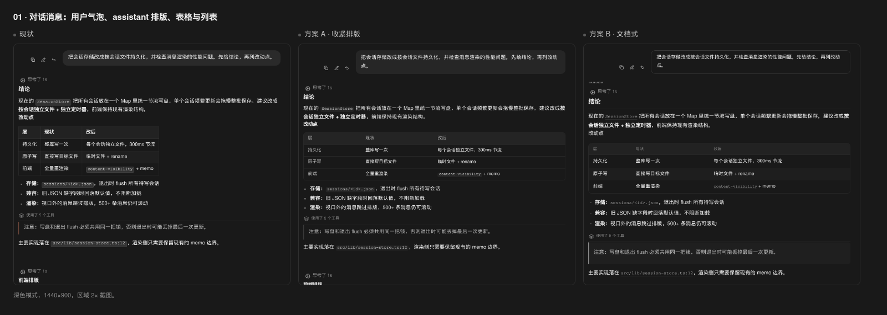
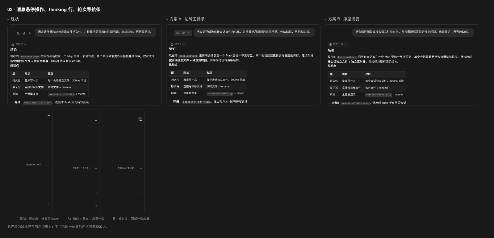
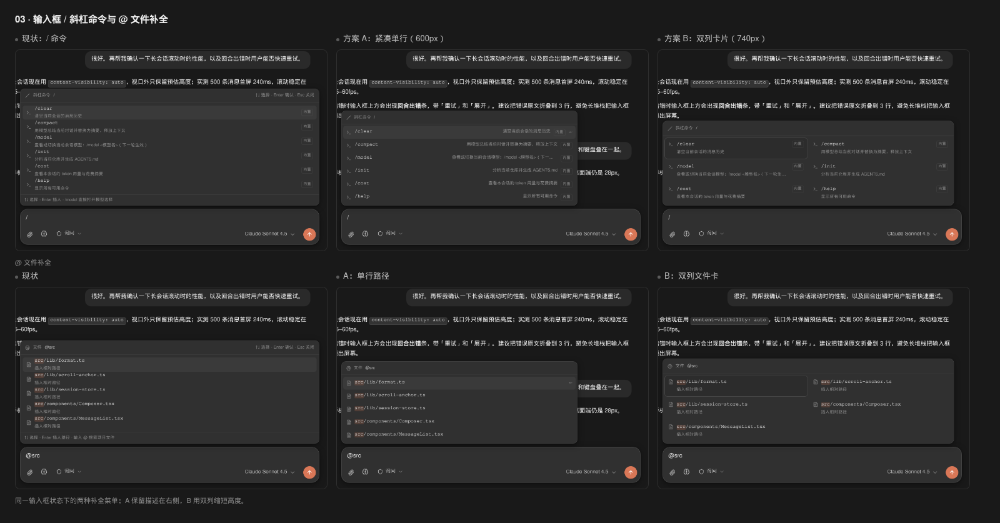
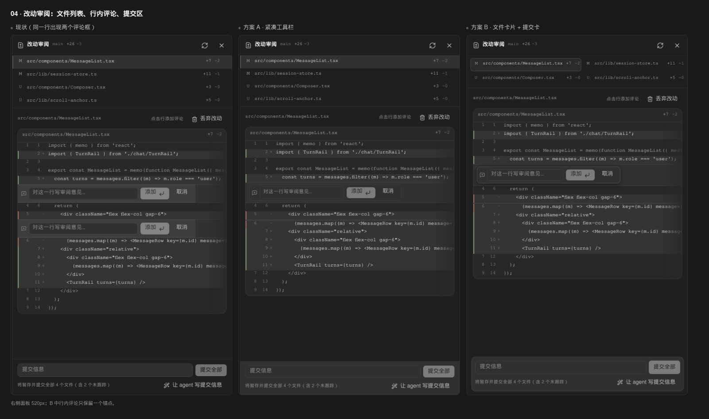
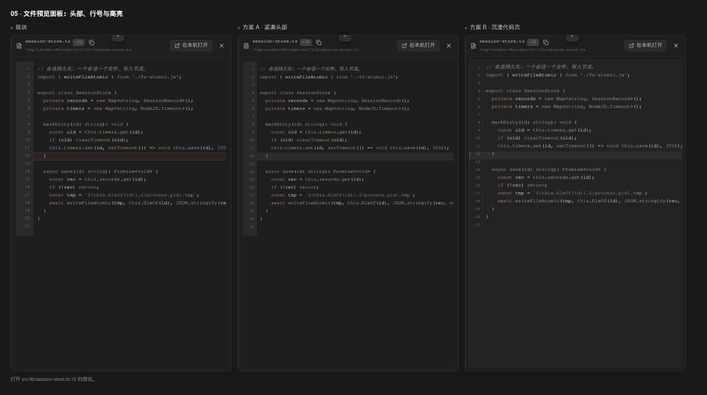
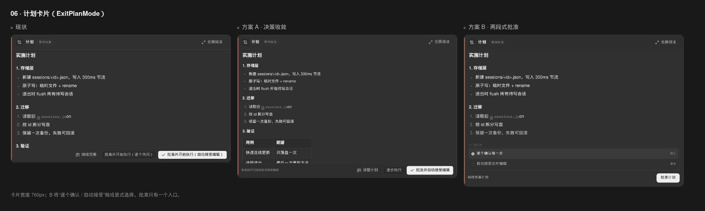
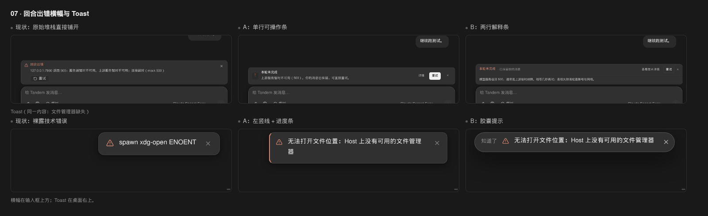
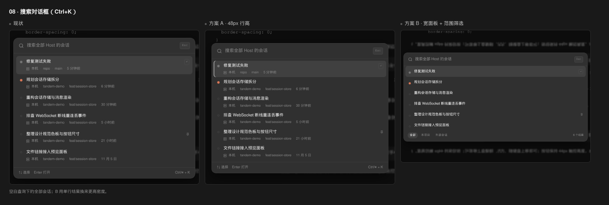
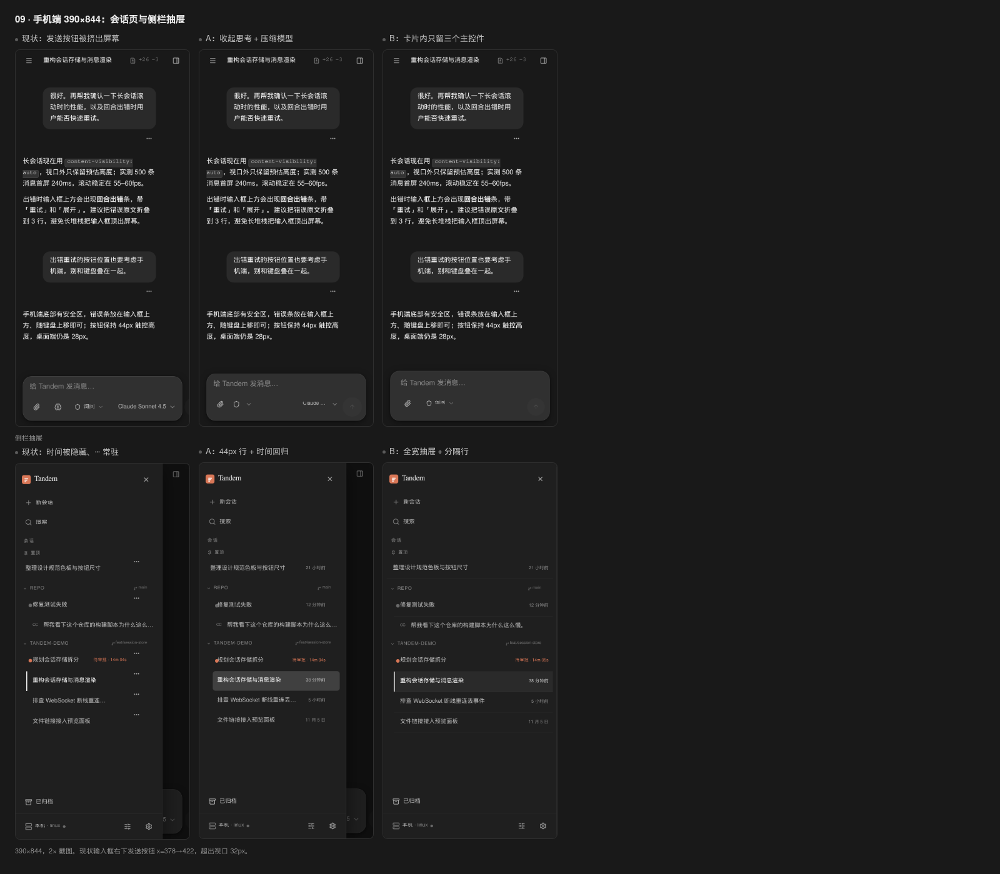
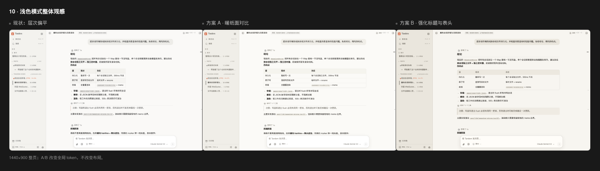

# Tandem UI 打分卡 · 第二版

深色模式、1440×900（手机端 390×844），基于当前 `packages/web/dist` 的真实界面。假数据：3 个账号、6 个 Tandem 会话、1 个外部会话、一个含 4 个文件改动的 git 工作区，消息含 Markdown 表格/列表/标题/代码、工具调用、thinking、计划审批与回合错误。截图按 2× 缩放，拼图统一 1600px 宽、`#191919` 背景。**未修改 `packages/` 下任何文件**。

**怎么用**：每节先看「问题」，再给各方案打分（1–5，5 = 最该改），最后看推荐与实现备注。也可直接回复编号 + 分数。

## 总表

| # | 区域 | 我认为的问题度 | 你的评分（1–5） | 我的推荐 |
|---|---|---|---|---|
| 01 | 对话消息：气泡、标题、表格、列表 | 5 |  | A |
| 02 | 消息悬停操作、thinking 行、轮次导航 | 4 |  | A |
| 03 | 输入框 / 与 @ 补全菜单 | 4 |  | A |
| 04 | 改动审阅：文件列表、行内评论、提交区 | 5 |  | B |
| 05 | 文件预览面板：头部、行号、行高亮 | 3 |  | A |
| 06 | 计划卡片（ExitPlanMode） | 4 |  | B |
| 07 | 回合出错横幅与 Toast | 4 |  | A |
| 08 | 搜索对话框（Ctrl+K） | 3 |  | B |
| 09 | 手机端会话页 + 侧栏抽屉 | 5 |  | 会话 B + 抽屉 A |
| 10 | 浅色模式整体观感 | 4 |  | B |

两个跨页面的硬问题：**手机端输入框的发送按钮实际被挤出屏幕**（390 宽下发送按钮 x=378→422）；**同一行号在 diff 的新旧两侧各渲染了一个评论框**。这两处不是审美问题，建议优先修。

---

## 01 对话消息：气泡、标题、表格、列表

**位置**：对话区用户气泡与 assistant Markdown（标题、表格、无序/有序列表、行内代码、引用）。

**问题**：表格仍是「每个单元格一圈 1px + 斑马纹」，在深色里像 Excel，压过了正文；`h2` 与正文只差 2px，标题层级几乎读不出来；行内代码带一圈边框，短句里出现一排「小胶囊」。用户气泡 16px 圆角 + 15px 字，长段落下沿很重。

- **方案 A · 收紧排版**：气泡 14px 圆角、宽度 80%；正文 14.5px/1.68；表格去竖线、只留行分隔与浅表头，13px；行内代码去边框；引用线改中性。
- **方案 B · 文档式**：assistant 加 9px `TANDEM` 小标签；h2 18px + 1px 下划线；表格变成 10px 圆角卡片、表头 11px 大写字距；列表换成「·」悬挂缩进；行内代码用下划线而不是底色。

**我的推荐**：A。它解决网格与层级，又不引入新标签；B 更像文档产品，气质更冷，适合以后做「阅读模式」开关。

---

## 02 消息悬停操作、thinking 行、轮次导航条

**位置**：用户气泡左侧的三个悬停图标、assistant 右下复制按钮、`思考了 Ns` 行、右侧的轮次刻度。

**问题**：三个 28px 图标裸放在气泡左侧 100px 处，和消息没有视觉连接；thinking 行 27px、11.5px 灰字，看起来像一条被禁用的工具行；轮次条是 7px 短横线，当前轮次只变长 1 倍，计数 `1/3` 只在 hover 时出现，长会话里几乎发现不了。

- **方案 A · 边缘工具条**：操作组变成 30px 带边框的浮层，紧贴气泡左侧；thinking 变 23px、左 1px 竖线 + 11.5px；轮次条改 1px 连续轨 + 4px 圆点，当前轮次 6×16 胶囊，`1/3` 常显。
- **方案 B · 浮层摘要**：thinking 收成 24px 胶囊（图标 + 文案）；操作按钮变 24px 无底色图标组；轮次条用 9px 长刻度 + 顶部计数胶囊，更像「目录」。

**我的推荐**：A。它把三个控件的关系理顺，且没有新增常驻元素；B 的胶囊 thinking 很讨喜，但操作组在截图里仍不够稳定，可留作局部。

---

## 03 输入框 / 与 @ 补全菜单

**位置**：输入框上方的斜杠命令菜单与 `@` 文件补全菜单（同一个 `CompletionMenu`）。

**问题**：菜单铺满 760px，每行「名称 + 描述」两行，图标垂直居中后落在第二行左侧，读起来像错位表格；斜杠命令重复显示「/ 斜杠命令 /」标题与底部同一句提示，实际只有 6 条命令却占了 300px 高。`@` 菜单每条都重复「插入相对路径」，路径没有目录/文件名的层级，选中项只靠一层浅底。

- **方案 A · 紧凑单行（600px）**：菜单收窄到 600px；每行 33px，命令名在左、描述右对齐、来源 `内置` 徽标；文件菜单只留路径，隐藏重复说明；底部提示删除，活跃行右侧显示 `↵`。
- **方案 B · 双列卡片（740px）**：保持输入框全宽，列表变 2 列卡片，每张 54px、名称 + 描述两行，选中卡片用强边框；文件菜单同样双列，用路径长度换高度。

**我的推荐**：A。补全菜单是高频瞬态界面，单行扫描最快，也不会挡住上方对话；B 的卡片适合命令更多、需要分类的以后。

---

## 04 改动审阅：文件列表、行内评论、提交区

**位置**：右侧 520px 改动审阅面板：顶部文件列表、diff 行内评论、底部提交信息与「提交全部」。

**问题**：文件列表每行 34px 却只有 11.5px 等宽路径，`M/U` 字母与 `+7 −2` 分列两端，像一张没有表头的表；行内评论框铺满整行、和 diff 行同色，两个按钮（添加/取消）把 520px 宽度吃光。更严重的是：在新增/删除两侧行号相同的行上点击，会同时出现**两个评论输入框**（`rowExtra` 只按行号匹配）。提交区把输入框、提交全部、文件数说明、让 agent 写提交信息挤在三行里，主操作只有 28px。

- **方案 A · 紧凑工具栏**：文件行压到 30px、丢弃按钮 hover 才出现；评论框 28px 输入 + 26px 按钮，浮在 diff 上；提交区统一 30px 控件。改动小。
- **方案 B · 文件卡片 + 提交卡**：文件列表变成 2 列 30px 卡片，带当前文件描边；diff 获得更多高度；行内评论只保留一个锚点、带阴影浮层；底部提交区变成独立圆角卡片，输入 + 主按钮一行，说明与「让 agent 写」降为 10.5px 辅助行。

**我的推荐**：B。文件卡片让 4–10 个文件的取舍一眼可见，提交区也终于像一个「完成动作」而不是脚注。无论选哪个，都要先修「同一行两个评论框」：`activeLine` 应记录 `side + line`，`rowExtra` 只在匹配的那一侧渲染。

---

## 05 文件预览面板：头部、行号、行高亮

**位置**：右侧文件预览：文件名/`:12` 行号、绝对路径、复制/本机打开、代码行号槽与第 12 行高亮。

**问题**：头部两行挤在 48px 里，文件名 12px、路径 10px，复制图标 24px；代码区从顶部开始但行号槽 44px 宽，代码被推到右侧；第 12 行高亮用了橙色底（`--t-accent` 8%），违反「橙只用于品牌/发送/焦点/待审批」的规则，且高亮横条比行号槽还宽，像选中了一整段。

- **方案 A · 紧凑头部**：头部合成一行 44px：文件名 + 行号 chip + 路径（截断）+ 操作；行号槽 34px；高亮改中性 `bg-hover` + 左侧 2px `border-strong`；代码字号 12px。
- **方案 B · 沉浸卡片**：代码区变成独立圆角卡，行号槽透明、与正文同一底色；头部路径一行、去掉操作按钮的抢眼边框；高亮完全中性。

**我的推荐**：A。预览面板是「顺手看一眼」的工具，头部信息必须一行读完；B 的沉浸式适合全屏阅读，不适合 560px 侧栏。

---

## 06 计划卡片（ExitPlanMode）

**位置**：输入框上方的计划审批卡：标题/等待批准、计划正文、底部「继续完善 / 批准并开始执行（逐个询问）/ 批准并开始执行（自动接受编辑）」。

**问题**：两个批准按钮的文案只差最后四个字，都是长句，用户必须逐字读才知道区别；正文 max-height 360px，计划到「验证」就被截断；「继续完善」和两个批准并列，主次只靠白底；卡头没有步骤数/影响文件等摘要。

- **方案 A · 决策收敛**：正文放宽到 44dvh（表格能完整出现）；底部左侧加一行「批准后将切换到自动接受编辑」；按钮改「调整计划 / 逐步执行 / 批准并自动接受编辑」，30px 高。
- **方案 B · 两段式批准**：正文 38dvh + 底部渐隐；在正文和按钮之间插入「逐个确认每一步（默认）/ 自动接受文件编辑（更快）」两条单选；底部只留「继续完善计划」文字 + 一个「批准计划」主按钮。

**我的推荐**：B。计划批准是高风险决策，应该先选「批准后怎么执行」，再点一次批准；B 把两个长按钮变成一个显式选择 + 一个主操作，语义最清楚。A 是低成本改良。

---

## 07 回合出错横幅与 Toast

**位置**：输入框上方的「回合出错」卡片；桌面右上角的 Toast。

**问题**：错误原文直接铺开：「127.0.0.1:7960 返回 500：服务端暂时不可用。上游服务暂时不可用：连接超时（mock 500）」——地址、状态码、重复句都进了首屏；「重试」是左侧 24px 小按钮，关闭在右上角很远。Toast 更直接：`spawn xdg-open ENOENT` 原样展示，没有「发生了什么/我能做什么」，4.5 秒后自动消失，用户来不及读。

- **方案 A · 单行可操作条**：横幅 52px：图标 + 「本轮未完成」+ 一句人话（「上游服务暂时不可用（500），消息已保留」）+ 右侧「详情 / 重试 / ×」；Toast 340px、左 2px 危险色、底部 2px 进度线，关闭按钮 hover 才出现。
- **方案 B · 两行解释条**：横幅两行：第一行状态 + 查看技术详情 + 重试，第二行给「通常是上游临时故障，稍等几秒再试」；Toast 变居中胶囊，文案前置「知道了」，更像轻提示。

**我的推荐**：A。错误反馈的第一职责是恢复动作，A 把「重试」放到右手主位，同时把技术细节收进「详情」；Toast 的进度线让 4.5 秒的消失变得可预期。实现上还需要在 `FilePreviewPanel` 的 catch 里把 `spawn ... ENOENT` 映射成「Host 上没有可用的文件管理器」。

---

## 08 搜索对话框（Ctrl+K）

**位置**：Ctrl+K 搜索全部 Host 会话的对话框：搜索框、结果列表、底部快捷键。

**问题**：结果每行 52px，却把「本机 · 项目 · 分支 · 时间」四个字段塞进 11px 一行，`本机` 和分支在每个结果里重复；没有「今天/更早」分组，也没有范围筛选；空白查询时把全部会话按时间平铺，选中行只靠一层灰底 + 右侧 `↵`。

- **方案 A · 48px 行高**：行高压到 46px，选中行加左侧 2px 竖线；元信息保留但字号降为 10.5px，状态点与标题基线对齐；底部提示保留。
- **方案 B · 宽面板 + 范围筛选**：面板 680px；每行 40px 单行：标题 + 右侧状态，结果列表底部加「全部 / 本项目 / 外部会话」范围条与结果计数，并隐藏原来的快捷键脚注。

**我的推荐**：B。搜索是键盘流，单行结果 + 底部范围条能用更少的视线移动找到目标；实现时把 `repoName` 保留成行内小 chip，避免丢掉跨项目上下文。

---

## 09 手机端（390×844）：会话页与侧栏抽屉

**位置**：手机端会话页顶部栏、消息流、底部输入框卡片；左滑侧栏抽屉。

**问题**：输入框底栏放不下：附件 44 + 思考 44 + 权限胶囊 + 模型 174 + 发送 44，总宽超过 358px，**发送按钮被挤到 x=378→422，完全在屏幕外**（实测）。抽屉里时间被 `hidden md:inline` 隐藏，`⋯` 按钮常驻占 32px；会话行 44px 但没有时间，用户分不清同名会话；选中行仍是桌面的 2px 左竖线。

- **方案 A · 收起思考 + 压缩模型**：隐藏思考入口，权限胶囊只留盾牌，模型截到 90px，发送固定右下；抽屉行 44px、时间回归、`⋯` 隐藏（长按/右键仍可呼出），选中改圆角浅底。
- **方案 B · 卡片内只留三个主控件**：输入框只留附件、权限、发送（模型与思考进会话信息面板），发送 40px；抽屉拉到全宽，行 46px + 细分隔线，选中用 inset 2px 竖线，分组更像原生列表。

**我的推荐**：会话页 B（先把发送按钮救回屏幕，模型切换交给信息面板）；抽屉 A（保留 87% 抽屉的空间感，同时让时间回归）。现状的发送按钮溢出是 P0。

---

## 10 浅色模式整体观感

**位置**：浅色模式下侧栏、顶栏、对话、表格、输入框的整体明度关系。

**问题**：`--bg #FAF9F7` 与 `--bg-sidebar #F3F2EE` 只差一点，侧栏和主区几乎连成一片；1px `rgba(0,0,0,.08)` 边框在白底上几乎看不见，表格却保留深色的斑马纹，变成「没有边界但有横条」；正文与次要文字对比都偏低，整页像被一层米色雾蒙住。

- **方案 A · 暖纸面对比**：主区 #FBFAF7、侧栏 #F0EEE8；边框提到 11%，强边框 20%；表格改圆角卡 + 仅横线 + 无斑马；行内代码 #EFECE4；输入框加一层暖阴影。
- **方案 B · 强化标题与表头**：主区 #F7F5F0、侧栏 #EAE6DD；h2 18px + 下划线；表头 #ECE8DF、表体保持纸色；引用块加暖底；输入框边框 26% + 更大阴影；正文近黑 #171410。

**我的推荐**：B。浅色模式现在缺的是「结构」，B 用更深的侧栏、更明确的表头与标题下划线把页面分层；A 更接近现有气质，可以作为 B 的降级版本。

---

## 实现备注（改哪里）

> 以下为建议落点，均未修改代码；同事正在改的侧栏/菜单/右侧栏/代码块/审批卡/diff/设置页不在本次范围。

1. **消息排版**：`packages/web/src/styles/chat.css` 的 `.md.chat-md table/th/td/thead`、`code`、`blockquote`、`li::marker`；`MessageList.tsx` 用户气泡的 `max-w-[85%]`、`rounded-2xl`、`px-4 py-2.5`。方案 A 不改 JSX。
2. **操作条 / thinking / 轮次**：`MessageList.tsx` 两处 `msg-actions` 的 `-left-[6.25rem]` / `bottom-1`；`ThinkingBlock.tsx` 的 `tool-row`；`styles/chat.css` 的 `.msg-actions`、`[data-thinking]`、`.turn-rail/.turn-tick/.turn-tick-line/.turn-rail-count`。轮次计数常显只需去掉 `.turn-rail-count` 的 `opacity:0` hover 规则。
3. **补全菜单**：`Composer.tsx` `CompletionMenu`（头部 36px、列表 `max-h-[264px]`、`.menu-item` 两行结构、`.menu-hint`）；A 方案在 `CompletionMenu` 外层加 `w-[600px]`，把第二行描述改为右对齐；文件菜单通过 `completion.kind` 条件渲染描述。`styles/chat.css` 的 `.menu-item`、`.menu-section`。
4. **改动审阅**：`ChangeReviewPanel.tsx` 的文件行（`min-h`、状态字母、`+/-`、`Trash2`）、`InlineComment`（宽度、`Input size="sm"`、按钮）、底部提交 `Input` + `Button`；重复评论框在 `activeLine` / `rowExtra`：把 `number` 改成 `${side}:${line}`，只在该侧渲染。B 的文件卡片用 `grid grid-cols-2` 包住现有行。
5. **文件预览**：`FilePreviewPanel.tsx` 头部两行（`min-h-12`、`text-[12px]`/`text-[10px]`、复制与「在本机打开」）；`CodeBlock.tsx` 的 `lineNumbers` 渲染；`styles/chat.css` 的 `.file-code-gutter`（44px → 34px）与 `.file-code-range`（`--t-accent` → `--t-border-strong` / `--t-bg-hover`）。
6. **计划卡片**：`PlanCard.tsx` 的 `max-h-[min(38dvh,360px)]`、底部 `Button` 文案与顺序；B 需要新增一个 `approvalMode` state（默认 `default`），把两个长按钮替换成两条 radio 行 + 单个 `decide(request.id, mode)`；`styles/chat.css` 的 `.permission-card`。不要改 `PermissionCard.tsx`（审批卡已定案）。
7. **错误与 Toast**：`ChatView.tsx` 的 `turnError` 块（标题、`line-clamp-3`、底部按钮）; `Toasts.tsx` 的容器与 `ICON_COLOR`；`useUiStore.ts` 的 4500ms 定时器（进度线时长要共用）。友好文案建议在 `FilePreviewPanel.tsx` 的 `catch` 里映射 `ENOENT`，或在 `lib` 加一个 `describeError()`。
8. **搜索**：`SearchDialog.tsx` 结果按钮（`min-h-11`、`text-[13px]`、元信息行）；A 只改行高与选中左线；B 给 `Modal` 传 `className="max-w-[680px]"`，在结果列表底部加 scope 条（本地 state），结果行改为单行 + 项目 chip。
9. **手机端**：`Composer.tsx` 底栏（`.composer-icon-btn` 44、`.composer-send` 44、模型 `Button` 的 `max-w-[220px]`、思考 `IconButton`）；`styles/chat.css` 的 `@media (max-width:767px)`。抽屉：`SessionList.tsx` 行时间的 `hidden ... md:inline`、`IconButton aria-label="会话操作"` 的 `opacity-100`、选中行的 `shadow-[inset_2px_0_0]`；`App.tsx` 的 `w-[87%] max-w-[330px]`。方案 B 的「隐藏模型/思考」用 CSS `display:none` 即可先验证，正式做时把入口收进信息面板。
10. **浅色模式**：`packages/web/src/index.css` 的浅色 token（`--t-bg`、`--t-bg-sidebar`、`--t-surface`、`--t-border`、`--t-border-strong`、`--t-text*`）；`styles/chat.css` 的 `.md.chat-md table` 需要把 `display:block` 改成 `display:table` 才能让表头底色铺满（当前浅色方案里已复现该问题）；`--t-code-bg` 同步。
