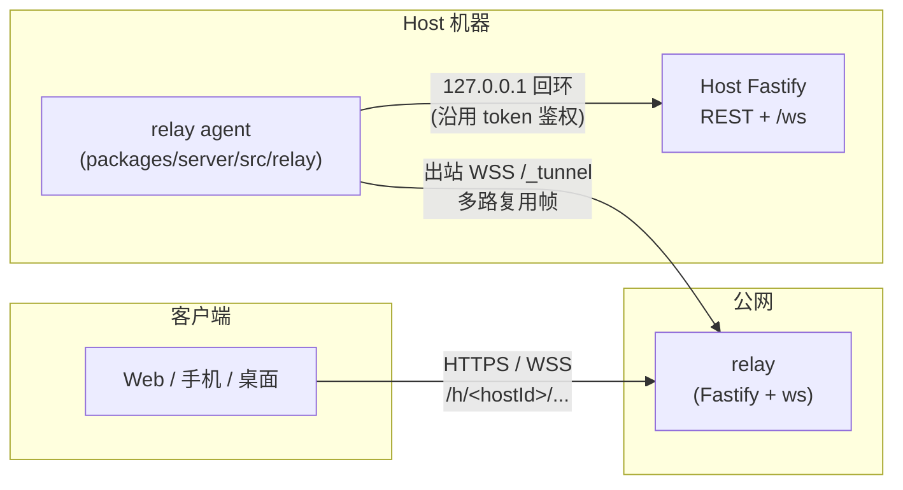

# 中继服务（@tandem/relay）

> 更新：2026-11-09。

让手机 / 另一台电脑在**不和 Host 同一局域网**时也能连上 Host（例如在 Windows 上管理远程 Linux 的任务）。Host 主动向公网 relay 建立**出站** WebSocket 隧道，Host 机器无需开放入站端口；客户端访问 `https://<relay>/h/<hostId>/...`，relay 经隧道把 HTTP 请求和 WebSocket 帧转发给 Host。

## 架构



- **隧道帧**：`[type u8][streamId u32][payload]`，每个 HTTP 请求 / WS 连接占一个 streamId。HTTP 响应体流式转发（SSE、大文件），响应方向有 1 MiB 窗口的 ACK 流控，relay 不会因慢客户端无限缓存。定义见 `packages/relay/src/wire.ts`。
- **token 不经 relay 校验**：relay 只转发，Host 照常校验 token（Bearer 或 `?token=`）。
- **hostId 所有权**：Host 用 Ed25519 密钥（`relay.hostKey`）注册。relay 先发随机挑战，Host 对 `hostId + 挑战` 签名；首次注册把 hostId 绑定到该公钥，之后只有同一公钥的签名才能接管（接管时旧连接被踢）。绑定记录在 relay 的 `<data>/registry.json`。
- **断线重连**：Host 指数退避（1s → 60s，带抖动），双方 20s 心跳检测半开连接。

## 部署

### 一键部署（推荐）

准备一台公网 Ubuntu/Debian 服务器，并将域名的 A/AAAA 记录指向它；防火墙放行 TCP 80、443。下载本仓库后执行：

```bash
cd /path/to/tandem
git pull
TANDEM_RELAY_DOMAIN=relay.example.com bash deploy/relay/install.sh
```

脚本会检测并安装 Docker/Compose，构建 relay 镜像，启动 relay + Caddy，并由 Caddy 自动申请和续期 HTTPS 证书。它可重复执行；数据保存在 Docker 卷中。也可先复制 `deploy/relay/.env.example` 为 `deploy/relay/.env`，填写 `TANDEM_RELAY_DOMAIN` 后直接运行脚本。脚本不会打印密钥或 token。

部署完成后，在每台 Host 上执行脚本输出的命令：

```bash
tandem-host --relay wss://relay.example.com
```

验证：`https://relay.example.com/healthz` 应返回 `ok: true`。Caddy 配置已包含 WebSocket 透传；不要绕过 Caddy 直接把 relay 暴露到公网。

### 无 Docker：systemd

先在 `/opt/tandem` 放置源码并构建 relay：

```bash
cd /opt/tandem
npm ci
npm run build -w @tandem/relay
sudo useradd --system --home /var/lib/tandem-relay --shell /usr/sbin/nologin tandem-relay || true
sudo install -d -o tandem-relay -g tandem-relay /var/lib/tandem-relay
sudo install -m 0644 deploy/relay/tandem-relay.service.example /etc/systemd/system/tandem-relay.service
sudo systemctl daemon-reload
sudo systemctl enable --now tandem-relay
```

`deploy/relay/tandem-relay.service.example` 是 unit 模板；仍需单独配置 Caddy 或 nginx 的 HTTPS 与 WebSocket 反向代理，目标为 `127.0.0.1:7950`。Node.js 要求 ≥ 20（模板默认 `/usr/bin/node`）。

### Host 配置

桌面端目前没有“中继地址”的托盘菜单或设置入口。可在 Host 侧运行上面的 `tandem-host --relay ...`（会写入 `~/.tandem/config.json`），或手动写入：

```json
{ "relay": { "url": "wss://relay.example.com", "hostKey": "<自动生成>", "requireE2E": false } }
```

首次启用会生成 `relay.hostKey` 并以 600 权限保存。启动日志会打印中继 URL 与**公钥指纹**。

relay 选项：`--max-hosts`（1000）、`--max-streams`（单 Host 并发请求/WS，256）、`--max-conns-per-ip`（128）、`--bandwidth <MB/s>`（单 Host 双向合计，16，0 不限）。`GET /healthz` 返回 `{ ok, hostsOnline }`。日志只记录 Host 上线/下线/拒绝（hostId 截断），不记录 URL、头部和 body。

## 连接方式

- **明文中继（无需改客户端）**：Host URL 填 `https://relay.example.com/h/<hostId>`，token 照旧。`GET /api/pair` 在启用 relay 时多返回 `relay` 字段并把该 URL 追加进 `urls`（此时不再返回 `loopback`）。
- **端到端加密（需要客户端接入）**：用 `@tandem/relay/client`：

  ```ts
  const ch = new E2EChannel({ baseUrl: 'https://relay.example.com/h/<hostId>', fingerprint })
  const res = await ch.fetch('/api/host', { headers: { Authorization: `Bearer ${token}` } })  // 返回标准 Response
  const ws = ch.openWebSocket(`/ws?token=${token}`)   // onopen / onmessage / onclose / send / close / readyState
  ```

  `fingerprint` 来自 Host 本地展示（启动日志 / 将来的配对二维码 / 本机访问 `/api/pair` 的 `relay.fingerprint`），**必须通过 relay 之外的渠道获得**。Host 配 `relay.requireE2E: true` 后拒绝一切明文中继请求。需要浏览器 / WebView 支持 WebCrypto 的 X25519 与 Ed25519（Chrome 137+、Firefox 129+、Safari 17+）。

## 端到端加密协议（v1）

- 身份：Host 的 Ed25519 公钥；指纹 = SHA-256(公钥原始 32 字节)，64 位十六进制。
- 握手 `POST /h/<id>/_e2e/hello`：客户端发临时 X25519 公钥 `epk_c`；Host 回临时公钥 `epk_h`、`sid`、Host 公钥，并对 `"tandem-e2e-v1|hostId|epk_c|epk_h"` 做 Ed25519 签名。客户端核对公钥指纹 = 配对指纹、验签通过后，双方 `HKDF-SHA256(ECDH 结果, salt=SHA256(transcript))` 导出两个方向的 AES-256-GCM 密钥。
- 请求 `POST /_e2e/http?sid=&n=`：body 是一条 AES-GCM 记录，内含 `{method, path, headers, body}`（token 在里面）。响应是 `[u32 长度][记录]` 序列：HEAD、若干 DATA、END，边界由 nonce `(n, 序号)` 绑定，截断 / 重排 / 跨请求替换都会解密失败。`n` 为单调计数，Host 用滑动窗口拒绝重放（409）。
- WebSocket `/_e2e/ws?sid=&n=&o=<加密的打开信封>`：每个方向的每条消息一条记录，nonce 序号严格递增。
- Host 重启 / 会话过期返回 410，客户端自动重新握手（请求尚未执行，可安全重试）。会话 24h 空闲过期，最多 256 个。

## 威胁模型

| 场景 | 明文中继（默认） | 端到端加密 |
|---|---|---|
| relay 读取请求 / 响应 / WS 内容 | **能**（relay 终结 TLS） | 不能，只见密文与长度 |
| relay 获取 token | **能**；token 等同于在 Host 上执行命令的权限，relay 被攻破 = Host 被接管 | 不能（token 在密文内） |
| relay 冒充 Host / 篡改内容 | **能** | 不能：没有 Host 私钥，无法通过指纹校验与签名；篡改、重放、重排、截断都会被检测 |
| relay 抢注别人的 hostId | 注册时需签名；首次绑定后他人无法接管，但“先到先得”（hostId 是 128 位随机 UUID，需先知道才能抢） | 同左；抢注只会造成连接失败（指纹不符），不会泄漏数据 |
| 网络窃听者 | 看不到（TLS） | 看不到（TLS + E2E） |
| 前向保密 | 取决于 TLS | 有：两端都是临时 X25519 密钥 |

**不保护的内容**：元数据（hostId、连接时间、请求次数与大小、客户端 IP）；可用性（relay 可以丢弃、延迟、拒绝服务）；WS 的关闭帧不带认证（只能造成断线）；客户端代码本身——**如果 Web UI 是经 relay 加载的，恶意 relay 可以篡改 JS 绕过 E2E**，所以 E2E 只在客户端代码来自可信来源（桌面 / 手机安装包，或本机 / 局域网直连 Host 加载）时成立；握手阶段客户端是匿名的，认证靠随后密文里的 token。

建议：自建 relay 且完全可信时可用明文模式；使用他人 / 公共 relay 时务必 `requireE2E: true` 并核对指纹。

## 后续计划

- ~~客户端接入~~（已完成：`packages/web/src/lib/relay.ts`；添加 Host 时填指纹，配对二维码携带指纹）。
- 为每台客户端设备签发独立密钥，替代共享 token；token 轮换。
- relay 访问控制（注册口令 / 邀请码）、按 hostId 的流量统计与配额、多实例部署（粘性路由）。
- 静态 Web UI 通过 relay 提供时的完整性校验（SRI / 签名清单）。
