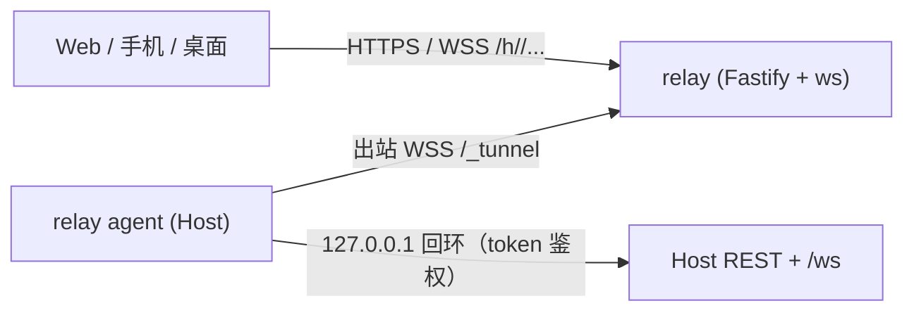

# 中继服务（@tandem/relay）

> 更新：2026-11-10。让手机/另一台电脑在**不和 Host 同局域网**时也能连上 Host：Host 主动向公网 relay 建**出站** WebSocket 隧道，无需开放入站端口；客户端访问 `https://<relay>/h/<hostId>/...`，relay 把 HTTP/WS 转发给 Host。

## 架构



- 隧道帧 `[type u8][streamId u32][payload]`，每个 HTTP/WS 一个 streamId；响应体流式转发，1 MiB 窗口 ACK 流控。定义见 `packages/relay/src/wire.ts`。
- relay 不校验 token，只转发；Host 照常校验 Bearer 或 `?token=`。
- hostId 所有权：Host 用 Ed25519 对 `hostId + 挑战` 签名；首次绑定公钥，之后只有同一公钥能接管（旧连接被踢），记录在 relay `<data>/registry.json`。
- 断线重连：Host 指数退避 1s→60s（带抖动），双方 20s 心跳。

## 部署

一键（推荐）：Ubuntu/Debian + 域名 A/AAAA 指向该机，放行 80/443：

```bash
TANDEM_RELAY_DOMAIN=relay.example.com bash deploy/relay/install.sh
```

脚本安装 Docker/Compose、构建镜像、启动 relay + Caddy（自动 HTTPS）。也可先复制 `deploy/relay/.env.example` 为 `.env` 后运行。完成后在每台 Host 执行：

```bash
tandem-host --relay wss://relay.example.com
```

验证 `https://relay.example.com/healthz` 返回 `ok`。不要绕过 Caddy 直接暴露 relay。

无 Docker：构建 `@tandem/relay`，用 `deploy/relay/tandem-relay.service.example` + 自己的 Caddy/nginx（HTTPS + WS，目标 `127.0.0.1:7950`，Node ≥20）。

Host 配置：`tandem-host --relay ...` 写入 `~/.tandem/config.json`（`relay.url / hostKey / requireE2E`）。首次生成 `relay.hostKey`（600），启动日志打印公钥指纹。relay 参数：`--max-hosts`（1000）、`--max-streams`（256）、`--max-conns-per-ip`（128）、`--bandwidth`（16 MB/s，0 不限）。

## 连接方式

- **明文中继**：Host URL 填 `https://relay.example.com/h/<hostId>`，token 照旧；`GET /api/pair` 多返回 `relay` 字段并写入 `urls`。
- **端到端加密**：用 `@tandem/relay/client` 的 `E2EChannel`（`baseUrl` + `fingerprint`），`fetch` / `openWebSocket` 与普通 API 同形。指纹必须通过 relay 之外的渠道获得；Host 配 `relay.requireE2E: true` 后拒绝一切明文请求。浏览器/WebView 需支持 X25519、Ed25519（Chrome 137+/Firefox 129+/Safari 17+）。

## 端到端加密（v1）

- 身份：Host Ed25519 公钥；指纹 = SHA-256(公钥 32 字节)。
- 握手 `POST /h/<id>/_e2e/hello`：客户端发临时 X25519 公钥，Host 回 `epk_h/sid/公钥` 并对 transcript 签名；客户端核对指纹后 `HKDF-SHA256(ECDH, salt=SHA256(transcript))` 导出双向 AES-256-GCM 密钥。
- HTTP：`POST /_e2e/http?sid=&n=`，body 为一条 AES-GCM 记录（含 method/path/headers/body/token）；响应为 `[u32 长度][记录]` 序列，nonce `(n, 序号)` 绑定，截断/重排/替换解密失败；Host 滑动窗口拒绝重放。
- WS：`/_e2e/ws?sid=&n=&o=`，每条消息一条记录，nonce 严格递增。
- Host 重启/会话过期返回 410，客户端自动重新握手；会话 24h 空闲过期，最多 256 个。

## 威胁模型

| 场景 | 明文中继 | E2E |
|---|---|---|
| relay 读请求/响应/WS | 能 | 不能，只见密文与长度 |
| relay 获取 token | 能（=Host 被接管） | 不能（token 在密文内） |
| relay 冒充/篡改 | 能 | 不能：指纹+签名+重放检测 |
| 抢注 hostId | 首次绑定后无法接管；hostId 128 位随机 | 同左，抢注只导致连接失败 |
| 网络窃听 / 前向保密 | TLS | TLS + 临时 X25519 |

不保护：元数据（hostId、时间、流量、IP）、可用性、WS 关闭帧；**Web UI 经 relay 加载时恶意 relay 可篡改 JS 绕过 E2E**，E2E 只适用于客户端代码来自可信来源（桌面/手机安装包或本机/局域网直连）。自建且完全可信可用明文；用他人/公共 relay 必须 `requireE2E: true` 并核对指纹。

## 后续与限制

- 已完成客户端接入；以后做每设备独立密钥、token 轮换、relay 访问控制/配额/多实例、静态 UI 完整性校验。
- 当前不保护元数据与可用性；relay 仍可拒绝服务。
